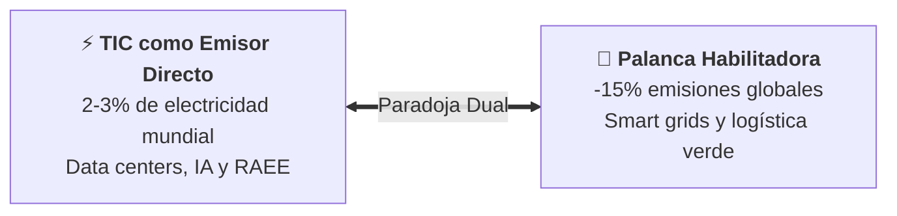
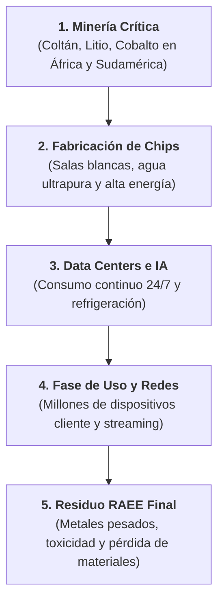

## Unidad 04 · Retos ambientales y sociales del sector informático

<span class="badge badge-ra">RA2 · Criterios a–e</span>
<span class="badge badge-alerta">Retos Críticos TIC</span>
<span class="badge badge-cloud">Centros de Datos & IA</span>
<span class="badge badge-hardware">RAEE & Minerales Críticos</span>

### Módulo 1708 · Sostenibilidad aplicada al sistema productivo

<div class="stat-grid">
  <div class="stat-card">
    <div class="stat-number">2% – 4%</div>
    <div class="stat-label">Emisiones globales GEI por TIC</div>
  </div>
  <div class="stat-card">
    <div class="stat-number">62 Mt</div>
    <div class="stat-label">RAEE generado al año en el mundo</div>
  </div>
  <div class="stat-card">
    <div class="stat-number">~200-400 TWh</div>
    <div class="stat-label">Consumo anual CPDs e IA</div>
  </div>
</div>

**Trabajas:** RA2 · criterios de evaluación **a** a **e**

**Hoy vas a:** caracterizar retos, analizar impactos y proponer acciones.

---

## Qué vas a aprender en esta unidad

### Al terminar serás capaz de...

- Identificar los **principales retos ambientales y sociales** del sector TIC.
- Relacionar cada reto con el **desarrollo de la actividad económica**.
- Analizar el efecto de los impactos sobre **personas y sectores productivos**.
- Proponer **medidas y acciones** concretas para minimizarlos.
- Defenderte **por qué hay que aliarse** y trabajar de forma transversal.

--

## Cita literal: RA2 (Real Decreto 659/2023, Anexo VIII)

> "Caracteriza los retos ambientales y sociales a los que se enfrenta la sociedad, describiendo los impactos sobre las personas y los sectores productivos y proponiendo acciones para minimizarlos."

En esta unidad trabajas **todos** los criterios de evaluación de ese resultado de aprendizaje.

--

## Criterios RA2.a y RA2.b, texto literal

- **a)** "Se han identificado los principales retos ambientales y sociales."
- **b)** "Se han relacionado los retos ambientales y sociales con el desarrollo de la actividad económica."

**Traducción:** primero los nombras, después los conectas con el negocio.

--

## Criterios RA2.c, RA2.d y RA2.e, texto literal

- **c)** "Se ha analizado el efecto de los impactos ambientales y sociales sobre las personas y los sectores productivos."
- **d)** "Se han identificado las medidas y acciones encaminadas a minimizar los impactos ambientales y sociales."
- **e)** "Se ha analizado la importancia de establecer alianzas y trabajar de manera transversal y coordinada para abordar con éxito los retos ambientales y sociales."

---

## Índice de la presentación

1. Por qué el sector TIC importa.
2. Retos ambientales del sector TIC.
3. Retos sociales del sector TIC.
4. Impacto sobre personas y sectores productivos.
5. Acciones para minimizar los impactos.
6. Alianzas y trabajo transversal.
7. Síntesis, autoevaluación y cuestionario final.

---

## 1 · El sector TIC: fuente de impacto y palanca de solución



El sector TIC es **simultáneamente** parte del problema y parte de la solución: no lo olvides nunca en una pregunta de examen. <!-- .element: class="fragment" -->

--

## Como fuente de impacto

- Consume **energía, agua y minerales críticos**. <!-- .element: class="fragment fade-up" -->
- Genera **residuos electrónicos (RAEE)** de difícil reciclaje. <!-- .element: class="fragment fade-up" -->
- El auge del **Cloud y la IA** dispara la demanda eléctrica global. <!-- .element: class="fragment fade-up" -->
- Su cadena de componentes es **global, opaca y dispersa**. <!-- .element: class="fragment fade-up" -->

--

## Como palanca de solución

- **Optimización industrial:** sensores IoT y algoritmos que ahorran combustible y energía. <!-- .element: class="fragment fade-up" -->
- **Habilita renovables:** gestión predictiva de la red eléctrica (*Smart Grids*). <!-- .element: class="fragment fade-up" -->
- **Descarbonización de la movilidad:** teletrabajo, software de rutas y virtualización. <!-- .element: class="fragment fade-up" -->
- **Smart Cities:** monitorización ambiental en tiempo real y gobernanza del agua. <!-- .element: class="fragment fade-up" -->

---

## Dato orientativo: cuánto pesa el sector TIC

- El sector TI representa aproximadamente entre el **1,5 % y el 2 %** del consumo eléctrico global.
- Concentra una parte **creciente** de las emisiones GEI.
- La **IA** puede multiplicar esa demanda en los próximos años (entrenamiento e inferencia de modelos).

--

## El efecto enabler: la digitalización que evita emisiones

- La digitalización puede evitar un porcentaje **significativo** de emisiones en otros sectores si se gestiona bien.
- Ejemplos: **industria 4.0** (menos material), **logística optimizada** (menos kilómetros), **telemedicina** (menos desplazamientos).
- A esto se le llama efecto **enabler** o habilitador.

**Conclusión:** el reto no es frenar la digitalización, es hacerla **sostenible**.

---

## 2 · Retos ambientales del sector TIC



### Los 6 grandes desafíos ambientales TIC:
1. **Consumo energético y emisiones GEI** (IA, cloud y redes). <!-- .element: class="fragment" -->
2. **Huella hídrica** (climatización evaporativa en zonas secas). <!-- .element: class="fragment" -->
3. **Residuos electrónicos (RAEE)** (62 millones de toneladas al año). <!-- .element: class="fragment" -->
4. **Minerales críticos** (dependencia de tierras raras y minería de conflicto). <!-- .element: class="fragment" -->
5. **Obsolescencia prematura** (hardware descartado por falta de parches de software). <!-- .element: class="fragment" -->
6. **Uso del suelo** (macrocentros de datos compitiendo con agricultura y vivienda). <!-- .element: class="fragment" -->

---

## Reto ambiental 2 · Huella hídrica

- La refrigeración **por evaporación** de los data centers consume grandes cantidades de agua.
- Muchas instalaciones están en regiones con **estrés hídrico**.
- KPI de referencia: **WUE**, expresado en litros por kWh.

--

## WUE: cómo se mide la sed del data center

- **WUE = litros de agua consumida / energía de los sistemas IT.**
- Un WUE alto en zona de sequía genera **conflicto social** con la comunidad local.
- Alternativas: refrigeración cerrada, reutilización de agua y **ubicación inteligente**.

---

## Reto ambiental 3 · Residuos electrónicos (RAEE)

- El sector genera uno de los flujos de residuos que **más crece**: móviles, PCs, servidores, baterías y componentes.
- Gran parte se desecha en condiciones **inadecuadas**.
- Consecuencias: **pérdida de materiales valiosos** y contaminación de suelo, agua y aire.

--

## Qué es un RAEE y por qué crece tan rápido

- **RAEE:** residuo de aparato eléctrico o electrónico, ya sea doméstico, profesional o industrial.
- Crecimiento por: ciclos de renovación cortos, **obsolescencia** y acumulación en casa.
- Contiene **metales preciosos** (oro, plata, cobre) difíciles de recuperar si se tritura mal.

---

## Reto ambiental 4 · Minerales críticos y cadena de suministro

- La electrónica depende de **litio, cobalto, níquel, cobre, oro, plata y tierras raras**.
- Su extracción provoca impacto ambiental: **contaminación y deforestación**.
- También impacto social: **condiciones laborales** y conflictos territoriales.
- La **trazabilidad** de dónde viene cada gramo sigue siendo un reto enorme.

--

## Lista de minerales críticos que conviene recordar

| Mineral | Uso típico en TIC |
|---------|-------------------|
| **Litio** | Baterías de portátiles y dispositivos. |
| **Cobalto** | Baterías y aleaciones. |
| **Cobre** | Cableado, placas y disipación. |
| **Oro y plata** | Contactos y circuitos. |
| **Tierras raras** | Pantallas, imanes y micrófonos. |

--

## Doble impacto de la extracción de minerales

- **Ambiental:** deforestación, contaminación del agua con metales pesados, consumo energético.
- **Social:** trabajo infantil y forzado en algunas zonas, salarios bajos, desplazamiento de comunidades.
- Por eso la **trazabilidad** es un reto ambiental y social **a la vez**.

---

## Reto ambiental 5 · Obsolescencia programada y durabilidad

- Ciclos de renovación **cortos**, especialmente en móviles.
- Generan **consumo prematuro** del dispositivo y residuos anticipados.
- El producto se tira **aún funcionando** o con una batería degradada.

--

## El reglamento de ecodiseño de la UE responde

- Exige **durabilidad** y fiabilidad del producto.
- Obliga a la **reparabilidad** y a la disponibilidad de repuestos.
- Impulsa la **actualización** de software durante más tiempo.
- Mide el producto con **etiquetas** que el usuario entiende.

---

## Reto ambiental 6 · Uso del suelo e infraestructuras

- Los nuevos **data centers** ocupan terreno y compiten con otros usos.
- Impacto local: **ruido, agua y demanda energética**.
- Debe gestionarse con las **comunidades locales** y la administración.
- Encaja con los criterios de **ordenación territorial**.

---

## Comprueba lo aprendido: retos ambientales

1. Nombra **cuatro** retos ambientales del sector TIC.
2. ¿Por qué la refrigeración de un data center es también un **reto social**?
3. ¿Qué es un **RAEE** y qué materiales pierdes si se gestiona mal?
4. ¿Qué reglamento europeo responde frente a la obsolescencia?

--

## Respuestas: retos ambientales

1. Energía y emisiones, huella hídrica, residuos electrónicos, minerales críticos, obsolescencia y uso del suelo.
2. Porque el agua consumida puede faltar en la **comunidad local**, sobre todo en zonas con estrés hídrico: el impacto ambiental se vuelve conflicto social.
3. Es un **residuo de aparato eléctrico o electrónico**; se pierden oro, plata, cobre y tierras raras, además de contaminar si se trata mal.
4. El **reglamento de ecodiseño de la Unión Europea**.

---

## Errores frecuentes: retos ambientales

- Decir que el mayor consumo TIC está en las **oficinas**: el grueso está en **data centers** y redes.
- Olvidar que los **chips** concentran emisiones de Alcance 3, no de Alcance 1.
- Afirmar que los RAEE son solo un problema de **contaminación**: también es **pérdida de recursos económicos**.
- Confundir **huella hídrica** con huella de carbono.

---

## Trucos para el examen: retos ambientales

- Asocia cada reto a su **KPI**: energía → PUE y tCO₂e; agua → WUE; residuos → kg de RAEE.
- Ante "justifica el reto", escribe siempre **causa → impacto → quién lo sufre**.
- Los retos TIC tienen **doble lectura**: ambiental y social. Dilo explícitamente para sumar puntos.

---

## 3 · Retos sociales del sector TIC

### Mapa rápido

1. Brecha digital y desigualdad.
2. Condiciones laborales en la cadena de suministro.
3. Privacidad y protección de datos.
4. Ética de la inteligencia artificial.
5. Brecha de género e inclusión.
6. Salud y bienestar del personal técnico.

--

## Reto social 1 · Brecha digital y desigualdad

- Acceso **desigual** a conectividad, dispositivos y competencias digitales.
- Se agrava por **edad, renta, género y territorio**.
- Afecta a la **educación**, al **empleo** y a los **servicios públicos**.

--

## Dimensiones de la brecha digital

| Dimensión | Ejemplo concreto |
|-----------|------------------|
| **Acceso** | Pueblos sin fibra o sin cobertura móvil. |
| **Dispositivo** | Familias sin ordenador para los deberes. |
| **Competencias** | Personas mayores sin gestiones telemáticas. |

Sin acceso, dispositivo y competencias, la **inclusión digital** es imposible.

---

## Reto social 2 · Condiciones laborales en la cadena de suministro

- Fábricas de componentes, muchas en **Asia**, con denuncias de:
  - Horas excesivas y salarios bajos.
  - **Trabajo infantil o forzado** en la minería de minerales.
- La **debida diligencia** es responsabilidad del **fabricante final**.

--

## Debida diligencia: ¿quién responde?

- El fabricante final no puede **desentenderse** de su cadena de suministro.
- Debe: identificar riesgos, **prevenirlos**, mitigarlos y dar cuenta de ello.
- En la UE, esta lógica se refuerza con la directiva de debida diligencia (**CSDDD**).

---

## Reto social 3 · Privacidad y protección de datos

- El modelo de negocio de muchos servicios digitales se apoya en **datos personales**.
- El mal uso genera **riesgos reales** para las personas: seguimiento, discriminación, fraude.
- Marco de referencia: **RGPD**.
- La **ciberseguridad** protege derechos fundamentales, no solo servidores.

--

## RGPD y ciberseguridad protegen derechos

- **RGPD:** derechos de acceso, rectificación, supresión y oposición.
- **Ciberseguridad:** evita filtraciones que hagan efectivos esos riesgos.
- **NIS2:** obliga a sectores esenciales, incluidas muchas TIC, a gestionar la ciberseguridad.
- Un incidente de privacidad se traduce en **sanciones y pérdida de confianza**.

---

## Reto social 4 · Ética de la inteligencia artificial

- **Sesgos algorítmicos** que discriminan por género, edad o origen.
- **Opacidad:** no siempre se sabe por qué la IA decide así.
- **Automatización con impacto en el empleo.**
- **Deepfakes** y **desinformación**.

--

## Gobernanza de la IA: un reto doble

- Es un reto **social**: afecta a derechos, empleo y convivencia.
- Y un reto de **gobernanza**: quién decide, quién audita y quién responde.
- Respuestas: auditorías de **sesgo**, **transparencia** y **comités de ética**.

---

## Reto social 5 · Brecha de género e inclusión en el sector

- El sector TIC tiene **menor presencia femenina** que la media económica.
- La falta de diversidad reduce la **innovación** y perpetúa sesgos en productos.
- Objetivos vinculados: **ODS 5** (igualdad) y **ODS 8** (trabajo decente).

---

## Reto social 6 · Salud y bienestar del personal técnico

- **Sedentarismo**, jornadas frente a pantalla y malas posturas.
- **Estrés**, sobrecarga y conectividad permanente.
- Efectos del **teletrabajo**: aislamiento y difuminación de la jornada.
- Vinculado al **ODS 3** (salud y bienestar).

---

## Comprueba lo aprendido: retos sociales

1. Lista **cuatro** retos sociales del sector TIC y justifica cada uno.
2. ¿Por qué la ciberseguridad es una cuestión de **derechos** y no solo técnica?
3. Menciona **tres** riesgos éticos de la inteligencia artificial.
4. ¿Qué relación tiene la brecha digital con la **educación** y el **empleo**?

--

## Respuestas: retos sociales

1. Brecha digital (exclusión), condiciones laborales de la cadena de suministro (derechos), privacidad (mal uso de datos), ética de la IA (sesgos y desinformación), género (desigualdad) y salud (estrés y sedentarismo).
2. Porque un filtrado expone datos personales y vulnera derechos fundamentales; la seguridad es el escudo de la **privacidad**.
3. Sesgos algorítmicos, opacidad de las decisiones, automatización del empleo, deepfakes y desinformación.
4. Sin acceso ni competencias, se pierden oportunidades de **formación** y de **puesto de trabajo**, creando desigualdad territorial y de renta.

---

## Errores frecuentes: retos sociales

- Resumir los retos sociales en **"la brecha digital"**: son seis y hay que nombrarlos todos.
- Pensar que la privacidad es solo un problema de **marketing**: afecta a derechos fundamentales.
- Olvidar que la **salud** también es un reto del sector, incluido el teletrabajo.

---

## 4 · Impacto sobre personas y sectores productivos

### Criterio RA2.c

| Reto | Efecto sobre las personas | Efecto sobre los sectores productivos |
|------|---------------------------|--------------------------------------|
| Emisiones GEI | Salud: calor y calidad del aire; costes sanitarios. | Costes energéticos, regulación y transición industrial. |
| Estrés hídrico | Acceso al agua en las comunidades locales. | Riesgo operativo de data centers; conflictos por el uso del agua. |
| Residuos electrónicos | Contaminación y salud en vertederos informales. | Pérdida de materiales valiosos; costes de cumplimiento RAEE. |

--

## Impactos sobre personas y sectores (continuación)

| Reto | Efecto sobre las personas | Efecto sobre los sectores productivos |
|------|---------------------------|--------------------------------------|
| Minerales críticos | Condiciones laborales y comunidades mineras. | Seguridad de suministro y volatilidad de precios. |
| Brecha digital | Exclusión social, laboral y educativa. | Pérdida de mercado y productividad. |
| Privacidad e IA | Riesgo para los derechos fundamentales. | Reputación, sanciones legales y pérdida de confianza. |

--

## Punto didáctico: las tres dimensiones inseparables

- Todo impacto **ambiental** tiene dimensión **social** (salud, agua, empleo).
- Todo impacto **social** tiene dimensión **económica** (costes, mercado, sanciones).
- La **sostenibilidad integra las tres**: ambiental, social y económica.

**Formulación estrella:** "los impactos ambientales tienen siempre una dimensión social y económica, y viceversa".

---

## Comprueba lo aprendido: impactos

1. ¿Qué efecto tienen las **emisiones GEI** sobre las personas?
2. ¿Cómo afecta el **estrés hídrico** a un sector productivo?
3. ¿Por qué la **brecha digital** perjudica a las empresas?
4. ¿Qué efectos tiene un mal uso de los **datos personales**?

--

## Respuestas: impactos

1. Peor salud por calor y contaminación del aire, con **mayores costes sanitarios**.
2. genera **riesgo operativo** para los data centers y conflictos por el uso del agua con la comunidad.
3. Pierde **mercado, talento y productividad**: no puede vender ni contratar bien donde la población no está digitalizada.
4. Daño a los derechos fundamentales y, para la empresa, **reputación, sanciones y pérdida de confianza**.

---

## 5 · Acciones para minimizar los impactos

### Criterio RA2.d

### Mapa de cinco frentes

1. Diseño y tecnología.
2. Energía y agua.
3. Ciclo de vida y residuos.
4. Cadena de suministro.
5. Social y gobernanza.

--

## Acciones 1 · Diseño y tecnología

- **Ecodiseño:** durabilidad, reparabilidad, eficiencia energética y materiales reciclados.
- **Eficiencia de software:** código optimizado que consume menos recursos.
- **Data centers eficientes:** PUE bajo, refrigeración natural o free cooling y ubicación en zonas frías o con renovables.

--

## Eficiencia de software: código que ahorra energía

- Menos instrucciones y menos acceso a disco = **menos energía por transacción**.
- Optimizar **consultas, bucles e imágenes** reduce el consumo del data center.
- Es la acción más barata: ahorra **dinero y emisiones** a la vez.
- Encaja con el concepto de **ecoeficiencia**.

--

## Data centers eficientes: tres palancas

| Palanca | Acción concreta | Efecto |
|---------|-----------------|--------|
| **Refrigeración** | Free cooling y refrigeración líquida. | Baja el PUE. |
| **Ubicación** | Zonas frías y con renovables. | Menor huella y menor coste. |
| **Equipos** | Virtualización y apagado de servidores ociosos. | Menos energía IT. |

---

## Acciones 2 · Energía y agua

- Compromiso con **energía 100 % renovable**: contratos PPA y autoconsumo.
- Reducción de la **huella hídrica**: refrigeración cerrada, reutilización de agua y ubicación inteligente.

--

## PPA y autoconsumo, explicados rápido

- **PPA:** contrato a largo plazo con un productor renovable; fija precio y garantiza origen renovable.
- **Autoconsumo:** paneles solares en cubierta del data center o de la oficina.
- Ambos elevan el **porcentaje de energía renovable**, un KPI de CDP y GRI.

--

## Reducir la huella hídrica en tres pasos

1. **Medir** con el WUE actual.
2. **Cambiar** a refrigeración cerrada o circuito con reutilización.
3. **Ubicar** la instalación donde el agua no compita con la población.

**Bonus:** si hay excedente de calor, reutilízalo en calefacción distrital.

---

## Acciones 3 · Ciclo de vida y residuos

- **Economía circular:** reventa, reacondicionado, reciclaje y recuperación de materiales.
- Programas de **recogida** (take-back) y **certificación RAEE**.
- Alargamiento de la **vida útil**: actualizaciones y garantía extendida.

--

## Economía circular en el sector TIC

| Estrategia | Ejemplo TIC |
|------------|-------------|
| **Reventa** | Venta de equipos devueltos y revisados. |
| **Reacondicionado** | Portátiles de empresa reciclados para formación. |
| **Reciclaje** | Recuperación de oro y cobre de placas. |
| **Alargamiento** | Actualizaciones de software durante más años. |

---

## Acciones 4 · Cadena de suministro

- Política de **proveedores con criterios ASG**.
- **Auditorías** periódicas a proveedores críticos.
- **Trazabilidad** de los minerales críticos.
- **Debida diligencia** en derechos humanos y medio ambiente (CSDDD).

--

## Trazabilidad de minerales críticos, paso a paso

1. **Mapear** qué minerales usa cada producto.
2. **Identificar** origen y intermediarios.
3. **Exigir** certificados y auditorías al proveedor.
4. **Reportar** el resultado en el informe de sostenibilidad.

**Dificultad real:** las cadenas tienen muchos eslabones y poca transparencia.

---

## Acciones 5 · Social y gobernanza

- Programas de **inclusión digital** y formación (ODS 4 y ODS 10).
- Políticas de **diversidad e inclusión** (ODS 5 y ODS 8).
- **Ética de la IA:** auditorías de sesgo, transparencia y comités de ética.
- Cumplimiento de **RGPD y NIS2** y cultura de ciberseguridad.

--

## Ética de la IA y ciberseguridad en la práctica

- **Auditorías de sesgo** antes de lanzar un modelo a producción.
- **Transparencia:** informar al usuario de que interactúa con una IA.
- **Comité de ética** con perfiles técnicos y no técnicos.
- **Formación continua** en ciberseguridad para todo el personal.

---

## Comprueba lo aprendido: acciones

1. Propón **tres** acciones para minimizar la huella hídrica de un data center.
2. ¿Qué es la **economía circular** aplicada a los equipos informáticos?
3. ¿Qué papel juegan las **auditorías a proveedores**?
4. Menciona **dos** acciones de gobernanza frente a la IA.

--

## Respuestas: acciones

1. Refrigeración cerrada o free cooling, reutilización del agua de proceso y **ubicación inteligente** lejos de zonas con estrés hídrico.
2. Mantener el valor de los equipos: **reventa, reacondicionado, reciclaje** y recuperación de materiales en lugar de desechar.
3. Verifican que los proveedores cumplan criterios **ASG**, permiten la **trazabilidad** y respaldan la debida diligencia.
4. Auditorías de **sesgo** y creación de un **comité de ética** con transparencia hacia el usuario.

---

## Errores frecuentes: acciones

- Proponer solo acciones **simbólicas** (reciclar pilas) sin atacar la causa: energía, durabilidad y cadena de suministro.
- Confundir **reciclaje** con **economía circular**: reciclaje es un eslabón, la circularidad es el modelo completo.
- Olvidar la acción **social** cuando la pregunta pide minimizar impactos en general.

---

## 6 · Alianzas y trabajo transversal

### Criterio RA2.e

Ningún reto TIC se resuelve en solitario: necesitas **alineación** dentro y fuera de la organización.

--

## Alianzas público-privadas y colaboración sectorial

- **Público-privadas:** smart cities, digitalización de la administración e I+D+i verde.
- **Sectorial:** estándares abiertos (PUE y WUE), plataformas comunes y coaliciones climáticas del sector TI.
- El resultado compartido: **menos coste, más impacto y mercado ampliado**.

--

## Cooperación internacional

- Los retos son **globales**: clima, minerales y datos no conocen fronteras.
- Requieren **acuerdos multilaterales** y armonización regulatoria.
- Evita el **doble estándar**: una empresa debe cumplir el mismo criterio en todos los países.

--

## Transversalidad interna: quién debe involucrarse

- **I+D:** ecodiseño y eficiencia.
- **Compras:** criterios ASG en los proveedores.
- **RRHH:** diversidad, formación y salud.
- **Jurídico:** cumplimiento RGPD, NIS2 y CSRD.
- **Ciberseguridad** y **dirección general:** riesgo y estrategia.

**Clave:** la sostenibilidad **no es solo el área de medio ambiente**.

---

## Ejemplo TIC: alianza con beneficio triple

Una consultora del sector se alía con administraciones para digitalizar servicios públicos de forma **eficiente y accesible**.

- **Sociedad:** servicios accesibles y mejores (ODS 16).
- **Sector:** nuevo mercado y buenas prácticas.
- **Planeta:** procesos más eficientes, menos papel y menos desplazamientos.

--

## Desglose del beneficio triple

| Dimensión | Beneficio concreto |
|-----------|--------------------|
| **Personas** | Acceso universal a trámites; inclusión digital. |
| **Economía** | Mercado estable para la empresa; eficiencia administrativa. |
| **Planeta** | Menos recursos y energía por trámite. |

**Por qué es buen ejemplo:** une alianza público-privada, transversalidad interna y los tres pilares de la sostenibilidad.

---

## Comprueba lo aprendido: alianzas

1. Da un ejemplo de **alianza público-privada** en el sector TIC con beneficio triple.
2. ¿Qué aportan los **estándares abiertos** compartidos por el sector?
3. ¿Por qué la cooperación **internacional** es necesaria en estos retos?
4. Cita **cuatro** áreas internas que deben trabajar de forma transversal.

--

## Respuestas: alianzas

1. Digitalización de servicios públicos con una consultora TIC: mejora la accesibilidad, crea mercado y reduce recursos.
2. Permiten **comparar** (por ejemplo PUE y WUE), reducir costes y evitar que cada empresa invente su métrica.
3. Porque el clima, los minerales y los datos son **globales**; sin armonización se produce deslocalización regulatoria.
4. Por ejemplo: **I+D, compras, RRHH, jurídico, ciberseguridad y dirección general**.

---

## Errores frecuentes: alianzas y transversalidad

- Presentar la transversalidad como "coordinar entre departamentos" sin citar **cuáles**.
- Escribir que la sostenibilidad depende solo de **medio ambiente** o de **RRHH**.
- Olvidar que los retos globales exigen **armonización regulatoria**, no solo buenas intenciones.

---

## Trucos para el examen

- Estructura siempre las respuestas en **reto → impacto → acción → alianza**.
- Cita el **criterio** que te piden: identificar (a y b), analizar (c y e), proponer (d).
- Apóyate en **ODS**: 3 salud, 4 educación, 5 igualdad, 8 trabajo, 10 reducción de desigualdades, 16 instituciones.
- Usa **datos concretos**: 1,5–2 % del consumo eléctrico global, PUE, WUE.

---

## Aplica esto: plan de acción para un data center

**Enunciado:** tu empresa quiere reducir su impacto en un 20 % en dos años.

1. **Mide:** inventario GEI con ISO 14064-1, PUE, WUE y kg de RAEE.
2. **Energía:** contrato PPA para llegar al **100 % renovable**.
3. **Agua:** refrigeración cerrada y objetivo de **WUE**.
4. **Residuos:** programa take-back y reacondicionado de servidores.
5. **Personas:** formación y política de diversidad.
6. **Reporte:** informe GRI con aseguramiento externo.

--

## Aplica esto: tu informe de retos del sector

Redacta una página con esta estructura, tal como se pide en el RA2:

- **Retos** ambientales y sociales elegidos (dos y dos).
- **Relación** con la actividad económica de tu empresa.
- **Efecto** sobre personas y sobre el sector.
- **Acciones** propuestas, con su KPI de seguimiento.
- **Alianza** necesaria para ejecutarla.

**Evaluación:** si aparecen los cinco verbos del criterio, vas sobrado.

---

## 7 · Síntesis: ficha resumen

```
RETO AMBIENTAL TIC: energia/GEI, agua, residuos electronicos,
   minerales criticos, obsolescencia, uso del suelo.
RETO SOCIAL TIC: brecha digital, cadena de suministro laboral,
   privacidad, etica IA, genero/inclusion, salud del personal.

IMPACTO: ambiental -> personas (salud, agua) + sectores (costes,
   regulacion). Social -> personas (derechos, exclusion) + sectores
   (reputacion, mercado).
```

--

## Síntesis: ficha resumen (continuación)

```
ACCIONES: ecodiseño, eficiencia SW/HW, renovables, economia circular,
   trazabilidad de minerales, debida diligencia, inclusion digital,
   etica IA, ciberseguridad.

ALIANZAS: publico-privadas, sectoriales (estandares), internacionales
   y transversales internas.

DATO: el sector TI consume entre el 1,5 % y el 2 % de la electricidad
   global, y a la vez puede evitar emisiones en otros sectores.
```

---

## Cuestionario de autoevaluación · preguntas 1 a 3

1. Lista **cuatro retos ambientales** y **cuatro sociales** del sector TIC, justificando cada uno.
2. Explica cómo el sector TIC es a la vez **fuente de impacto** y **palanca de solución**.
3. Elige un reto, por ejemplo los **residuos electrónicos**, y traza su cadena de impacto sobre personas y sectores.

--

## Respuestas · autoevaluación 1 a 3

1. Ambientales: energía y GEI (data centers y IA), agua (refrigeración), RAEE (crecimiento del residuo) y minerales críticos (extracción). Sociales: brecha digital (acceso desigual), condiciones laborales (cadena suministro), privacidad (uso de datos) y ética de la IA (sesgos y desinformación).
2. Fuente de impacto: consume energía, agua y minerales y genera residuos. Palanca: digitaliza procesos, habilita renovables, permite teletrabajo y monitorización ambiental.
3. Generación de RAEE: las personas sufren **contaminación y problemas de salud**; el sector pierde **materiales valiosos** y asume costes de cumplimiento de la normativa RAEE.

---

## Cuestionario de autoevaluación · preguntas 4 a 6

4. Propón **tres acciones** para minimizar la huella hídrica de un data center.
5. ¿Por qué la **trazabilidad de minerales críticos** es un reto social y ambiental a la vez?
6. Da un ejemplo de **alianza público-privada** en el sector TIC con beneficio triple.

--

## Respuestas · autoevaluación 4 a 6

4. Refrigeración cerrada, reutilización del agua y ubicación inteligente fuera de zonas con estrés hídrico; además, medir con el **WUE**.
5. Porque la extracción contamina y deforesta (ambiental) y puede implicar condiciones laborales abusivas y daño a comunidades mineras (social).
6. Alianza entre una consultora TIC y una administración para digitalizar trámites: mejora la vida de las personas, crea mercado y reduce recursos.

---

## Resumen en 10 ideas (1 a 5)

1. El sector TIC es **fuente de impacto y palanca de solución** a la vez.
2. Consume entre el **1,5 % y el 2 %** de la electricidad global, y la IA lo multiplicará.
3. Los seis retos ambientales: **energía, agua, RAEE, minerales, obsolescencia y suelo**.
4. Los seis retos sociales: **brecha digital, cadena laboral, privacidad, IA, género y salud**.
5. Todo impacto ambiental tiene dimensión **social y económica**, y viceversa.

--

## Resumen en 10 ideas (6 a 10)

6. Las acciones se agrupan en cinco frentes: **diseño, energía y agua, ciclo de vida, suministro, social**.
7. Las palancas TIC por excelencia: **PUE, WUE, energía renovable y economía circular**.
8. La **debida diligencia** obliga a responder de toda la cadena de valor.
9. Ningún reto se resuelve solo: hacen falta **alianzas** y **transversalidad interna**.
10. Un buen plan usa la fórmula **reto → impacto → acción → alianza → KPI**.

---

## Cuestionario final · preguntas 1 a 4

1. ¿Por qué el sector TIC es a la vez **problema y solución** del reto climático?
2. Relaciona el **estrés hídrico** con las personas y con los sectores productivos.
3. ¿Qué es un **RAEE** y qué cuatro acciones podemos aplicarle?
4. Explica la diferencia entre **alcance 2** y **alcance 3** en el consumo energético TIC.

--

## Respuestas · cuestionario final 1 a 4

1. Porque consume mucha energía y genera residuos, pero a la vez **digitaliza y hace eficientes** a otros sectores, reduciendo sus emisiones.
2. Personas: falta de agua en la comunidad. Sectores: **riesgo operativo** del data center y conflictos por el uso del agua.
3. Residuo de aparato eléctrico o electrónico. Acciones: reventa, reacondicionado, reciclaje y **certificación take-back**.
4. El **alcance 2** es la electricidad comprada y consumida por la empresa; el **alcance 3** es la fabricación de chips y componentes y el resto de la cadena de valor.

---

## Cuestionario final · preguntas 5 a 8

5. ¿Qué relación tiene la **brecha digital** con la educación y el empleo?
6. Cita **tres** riesgos éticos de la IA y **dos** respuestas de gobernanza.
7. ¿Qué acciones concretas reducen el **PUE** de un data center?
8. ¿Qué es la **debida diligencia** y qué norma europea la refuerza?

--

## Respuestas · cuestionario final 5 a 8

5. Sin acceso, dispositivo ni competencias se pierden **formación, teleformación y puestos de trabajo**, aumentando la desigualdad.
6. Riesgos: sesgos, opacidad, automatización del empleo, deepfakes. Respuestas: auditorías de sesgo y comités de ética con transparencia.
7. Free cooling, refrigeración líquida, ubicación en zona fría, virtualización y apagado de servidores ociosos.
8. Identificar, prevenir, mitigar y dar cuenta de los impactos en la cadena de valor; la refuerza la directiva europea de debida diligencia, la **CSDDD**.

---

## Cuestionario final · preguntas 9 a 12

9. Enumera los **cinco frentes** de acción para minimizar impactos y da un ejemplo de cada uno.
10. ¿Qué papel juegan los **estándares abiertos** como el PUE en las alianzas sectoriales?
11. Cita **tres** ODS relacionados con los retos sociales del sector TIC y su vínculo.
12. Explica la importancia de la **transversalidad interna** citando cuatro áreas de la empresa.

--

## Respuestas · cuestionario final 9 a 12

9. Diseño (ecodiseño), energía y agua (renovable y WUE), ciclo de vida (economía circular), suministro (trazabilidad) y social (inclusión digital y ética de la IA).
10. Permiten **medir y comparar** a todas las empresas con la misma regla, reducen costes y evitan el greenwashing.
11. Por ejemplo: **ODS 3** (salud y bienestar), **ODS 5** (igualdad de género) y **ODS 10** (reducción de desigualdades); también ODS 4, 8 y 16.
12. Porque los retos no pertenecen a un solo departamento: se necesitan **I+D, compras, RRHH, jurídico, ciberseguridad y dirección**.

---

## Cierre · lo que te llevas de la Unidad 04

- Identificas los **seis retos ambientales** y los **seis retos sociales** del sector TIC.
- Relacionas cada reto con la **actividad económica** y con sus **efectos dobles**.
- Propones **acciones concretas** con su KPI de seguimiento.
- Defiendes las **alianzas** y la **transversalidad** como única vía de éxito.

**Siguiente paso:** economía circular, verde y ecodiseño.

**¡A por la evaluación!**

---

## Actividad · «El coste invisible de lo digital» (parejas o tríos)

> 1 sesión (50 min) + exposiciones y votación · Cubre RA2 (a–e) · Entregable: infografía con 6 retos

- **Consigna:** infografía con **6 retos TIC (3 ambientales + 3 sociales)**: dato con fuente, efecto sobre **personas** y sobre **sectores**, 1 **acción con KPI** y 1 **alianza transversal** al pie.
- **Pasos:** elegir los 6 retos → recopilar datos → trazar la cadena de impacto → acciones + KPI → diseñar.
- **Al acabar:** votación de los presentados — ¿cuál es el reto **más urgente**?

---

## Actividad · Entregable y presentación

- **Entregables:** infografía (PNG/PDF o lámina) + mínimo 4 fuentes + acción y KPI por reto.
- **Presentación:** 5 min por grupo + votación (5 min).
- **Se valora:** cobertura E/S (25 %) · datos con fuente (25 %) · cadena de impacto (20 %) · acciones (15 %) · diseño (15 %).
- **Conexión:** los retos más votados entran en el **diagnóstico del T1**.
