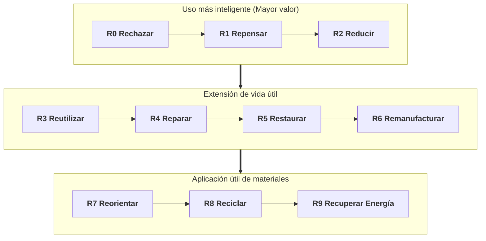
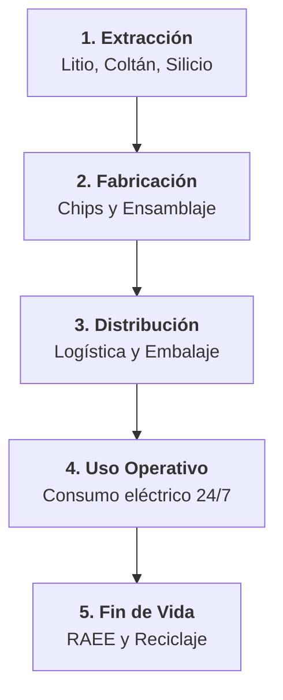
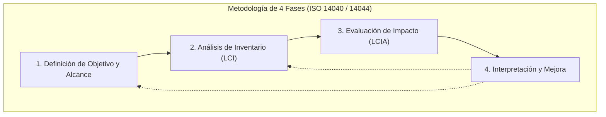

## Unidad 05 · Economía circular, ecodiseño y ciclo de vida

RA4 · Criterios a–f
Economía Circular 9R
Green Coding
Ecodiseño Hardware (ESPR)

**Módulo 1708 · Sostenibilidad aplicada al sistema productivo**

  

    
75% – 80%

    
Huella en fabricación de PCs

  

  

    
9R

    
Estrategias de circularidad

  

  

    
ISO 14040

    
Análisis de Ciclo de Vida

  

Del modelo lineal al ciclo de vida: cómo proponer productos y servicios TIC responsables.

---

## Qué vas a aprender en esta unidad

- Caracterizar el **modelo de producción y consumo actual** y sus problemas.
- Identificar los **principios de la economía verde y circular**.
- Contrastar sus **beneficios** frente al modelo clásico de producción.
- Aplicar **principios de ecodiseño** a hardware, software y servicios cloud.
- Analizar el **ciclo de vida** del producto (LCA).
- Identificar los **procesos de producción** y sus criterios de sostenibilidad.

> Al terminar sabrás proponer un producto o servicio TIC con criterios circulares y justificarlo con datos.

--

## El resultado de aprendizaje que trabaja esta unidad

> **RA4:** "Propón productos y servicios responsables teniendo en cuenta los principios de la economía circular."

Criterios de evaluación (RD 659/2023, Anexo VIII, BOE):

- a) "Se ha caracterizado el modelo de producción y consumo actual."
- b) "Se han identificado los principios de la economía verde y circular."
- c) "Se han contrastado los beneficios de la economía verde y circular frente al modelo clásico de producción."
- d) "Se han aplicado principios de ecodiseño."
- e) "Se ha analizado el ciclo de vida del producto."
- f) "Se han identificado los procesos de producción y los criterios de sostenibilidad aplicados."

---

## Índice: por dónde vamos a ir

1. El modelo lineal actual: extraer, producir, usar, tirar.
2. Economía circular: principios, ruedas y modelos de negocio.
3. Economía verde y beneficios frente al modelo clásico.
4. Ecodiseño: principios aplicables y marco normativo.
5. Análisis del ciclo de vida del producto (LCA).
6. Procesos de producción y criterios de sostenibilidad.
7. Síntesis, autoevaluación y cuestionario final.

---

## Bloque 1 · El modelo lineal: extraer, producir, usar, tirar

> Criterio RA4.a: "Se ha caracterizado el modelo de producción y consumo actual."

### Qué vas a hacer en este bloque

- Describir las **cuatro etapas** del flujo lineal con ejemplos del sector TIC.
- Explicar los **problemas** que genera cada etapa.
- Conectar cada problema con su **consecuencia ambiental o económica**.

---

## Las cuatro etapas del flujo lineal

1. **Extraer:** minerales críticos (litio, cobalto, cobre, tierras raras), metales, plásticos, vidrio y silicio.
2. **Producir:** fabricación de chips, placas y ensamblaje de dispositivos y servidores; consumo energético alto.
3. **Usar:** consumo eléctrico durante toda la vida útil; obsolescencia funcional y física.
4. **Tirar:** gran parte acaba en vertedero o en un reciclaje ineficiente; se pierden materiales valiosos.

--

## Ejemplo: el ciclo lineal de un portátil

- **Extraer:** litio y cobre para baterías y placas; aluminio para el chasis; tierras raras en pantallas.
- **Producir:** fundición de chips y montaje de la placa repartidos entre varios países.
- **Usar:** 4 a 6 años de consumo eléctrico y actualizaciones que, a veces, obligan a renovar antes de tiempo.
- **Tirar:** si no se recicla bien, el portátil pierde oro, cobre y tierras raras que ya estaban extraídos.

---

## Extracción y producción: la base material del sector TIC

### Extracción

- Minerales críticos: **litio, cobalto, cobre, tierras raras**, silicio y níquel.
- Plásticos y vidrio para carcasas, pantallas y cableado.

### Producción

- Fabricación de **chips** en fundiciones: mucha energía y mucha agua ultrapura.
- **Ensamblaje** de dispositivos y servidores: alta demanda energética y logística global.
- Concentración geográfica de la fabricación → riesgo de suministro y volatilidad de precios.

---

## Uso y fin de vida: dónde se pierde valor

### Durante el uso

- **Consumo eléctrico** continuo en portátiles, servidores y data centers.
- **Obsolescencia funcional:** el hardware vale, pero el software ya no lo soporta.
- **Obsolescencia física:** baterías agotadas, desgaste y averías.

### Fin de vida

- Vertedero o reciclaje ineficiente: se pierden materiales valiosos ya extraídos.
- Resultado: hay que extraer de nuevo (**minería primaria**).

--

## Obsolescencia funcional frente a obsolescencia física

| | Obsolescencia funcional | Obsolescencia física |
|---|---|---|
| Causa | El software o el servicio ya no lo soporta | Desgaste, batería, averías |
| Ejemplo TIC | PC que no aguanta la nueva versión del sistema | Móvil con la batería inservible |
| Solución circular | Actualizaciones y soporte prolongado | Reparación y repuestos |

**Ambas acortan la vida útil** y aceleran el modelo lineal.

---

## Los cuatro problemas del modelo lineal

| Problema | Consecuencia |
|----------|-------------|
| Finitud de recursos | Escasez y volatilidad de minerales críticos. |
| Residuos electrónicos | Uno de los flujos que más crece; contaminación. |
| Emisiones en la fabricación | Alcance 3 dominante; difícil de reducir sin rediseño. |
| Obsolescencia | Renovación prematura, más extracción y más residuos. |

--

## El dato que lo resume

> Se estima que solo una **fracción pequeña** de los metales de los aparatos eléctricos y electrónicos en desecho se recupera realmente.

- El resto se pierde → hay que **extraer otra vez** (minería primaria).
- Cada equipo nuevo que compras sin reaprovechar repite una extracción ya pagada.
- El fin de vida no es un detalle: es una **fuga de valor** del sistema.

---

## Comprueba lo aprendido · Modelo lineal

1. Ordena las cuatro etapas del modelo lineal y pon un ejemplo TIC en cada una.
2. ¿Qué dos tipos de obsolescencia aparecen en la fase de uso?
3. Relaciona cada problema del modelo lineal con su consecuencia.
4. ¿Por qué el reciclaje ineficiente obliga a nueva extracción?

--

## Respuestas · Modelo lineal

1. **Extraer → producir → usar → tirar.** Ejemplos: minerales críticos; fabricación de chips; consumo eléctrico del portátil; vertedero o reciclaje.
2. **Funcional** (el software ya no lo soporta) y **física** (baterías, desgaste, averías).
3. Finitud → escasez y volatilidad; residuos → contaminación; emisiones en fabricación → Alcance 3 dominante; obsolescencia → renovación prematura.
4. Porque los materiales valiosos se pierden y hay que **extraerlos otra vez**: el ciclo no se cierra.

---

## Bloque 2 · Economía circular: los principios

> Criterio RA4.b: "Se han identificado los principios de la economía verde y circular."

### Qué vas a hacer en este bloque

- Conocer los **tres principios** de la economía circular (Fundación Ellen MacArthur).
- Distinguir la **rueda técnica** y la **rueda biológica**.
- Identificar **modelos de negocio circulares** en el sector TIC.
- Separar el concepto de **economía verde** del de economía circular.

---

## Los tres principios de la economía circular

1. **Eliminar** residuos y contaminación desde el diseño (*design out waste*).
2. **Mantener** productos y materiales en uso: reutilización, reparación, reacondicionado y remanufactura.
3. **Regenerar** los sistemas naturales: energía renovable, suelos sanos y biodiversidad.

> No se trata de "gestionar mejor la basura", sino de **no diseñarla**.

--

## Los tres principios con un ejemplo TIC cada uno

- **Eliminar:** fabricar con menos piezas y sin materiales tóxicos; no sobredimensionar el equipo.
- **Mantener:** programa de **reparación** con repuestos y manuales; venta de equipos **reacondicionados** con garantía.
- **Regenerar:** data center alimentado con **energía 100 % renovable** y proveedores con cadenas de suministro auditadas.

---

## Qué significa "diseñar para no generar residuos"

- Reducir piezas y uniones que impiden el **desmontaje**.
- Evitar sustancias peligrosas (cumplir RoHS y REACH).
- Minimizar embalajes y usar **mono-material** para que se reciclen bien.
- Sobredimensionar menos: el equipo justo para la función que cumple.

--

## El marco de las 9R de la economía circular

--

## Jerarquía de valor en la electrónica

- Prioridad Máxima (R0–R2) Evitar compras superfluas, consolidar servidores y optimizar código. <!-- .element: class="fragment" -->
- Vida Útil (R3–R6) Reparación con repuestos disponibles, reacondicionado garantizado y modelos DaaS. <!-- .element: class="fragment" -->
- Fin de Ciclo (R7–R9) Reciclaje de alta calidad recuperando oro y coltán; la valorización energética es el último recurso. <!-- .element: class="fragment" -->

---

## Las dos ruedas de la economía circular

### Rueda técnica (ciclo cerrado)

- Recuperar componentes y materiales **sin perder valor**.
- Reparación → remanufactura → reciclaje de alta calidad.
- Es la rueda **dominante en electrónica**.

### Rueda biológica

- Materiales **biodegradables** que vuelven al ciclo natural.
- Poco relevante en los equipos, pero presente en **envases y embalajes**.

--

## La rueda técnica, paso a paso

- **Reparar:** alargar la vida del equipo que ya existe.
- **Reacondicionar:** revisar, actualizar y revender con garantía.
- **Remanufacturar:** recuperar bloques enteros para venderlos "como nuevos".
- **Reciclar de alta calidad:** los metales vuelven a ser materia prima.
- Objetivo: que el material **gire el mayor número de veces** antes de salir del sistema.

--

## La rueda biológica en TIC

- Aparece sobre todo en **envases, embalajes y consumibles**.
- Cartón, celulosa y plásticos compostables que vuelven al suelo.
- En equipos electrónicos casi no interviene: su ciclo es **técnico**, no biológico.
- No la ignores: el embalaje es la primera cara que ve el cliente.

---

## Cinco modelos de negocio circulares en TIC

| Modelo | Descripción | Ejemplo |
|--------|-------------|---------|
| Producto como servicio | Se alquila el equipo; el fabricante lo mantiene y recupera. | PC as a service en flotas corporativas. |
| Reacondicionado | Equipos revisados vendidos con garantía. | Programas de segunda vida. |
| Reciclaje avanzado | Recuperación de materiales del fin de vida. | Reciclaje de baterías y circuitos. |
| Actualización modular | Diseño que permite sustituir módulos. | Móviles modulares y reparables. |
| Eficiencia como servicio | Optimizar lo existente antes de comprar nuevo. | Optimización de capacidad en la nube. |

--

## Caso: PC as a service

- La empresa **no compra** portátiles: contrata el **servicio de cómputo**.
- El proveedor mantiene, repara, actualiza y, al final, **recupera** los equipos.
- Más reparación, menos compras nuevas y materiales recuperados.
- **Ingresos recurrentes** para el proveedor y menor desembolso inicial para el cliente.

---

## Economía verde: el complemento

La **economía verde** busca crecimiento que reduzca el riesgo ambiental y la pobreza, mejorando el bienestar. En TIC se traduce en:

- Productos y servicios que **ahorran energía y recursos** (eficiencia).
- **Innovación limpia:** software de descarbonización y monitorización ambiental.
- **Empleo de calidad** vinculado a la transición ecológica.

--

## Diferencia clave: circular frente a verde

| | Economía circular | Economía verde |
|---|---|---|
| Pregunta | ¿Cómo cierro los ciclos de materiales? | ¿Cómo oriento el crecimiento? |
| Palabra clave | Cerrar ciclos | Reducir riesgo ambiental y pobreza |
| En TIC | Reparar, reacondicionar, reciclar | Eficiencia, innovación limpia, empleo digno |

**Se refuerzan mutuamente:** un servicio TIC circular también es verde.

---

## Comprueba lo aprendido · Economía circular

1. Enumera los tres principios de la economía circular.
2. ¿Qué es la rueda técnica y por qué domina en electrónica?
3. Cita dos modelos de negocio circulares para una empresa de hardware.
4. ¿En qué se diferencia la economía verde de la economía circular?

--

## Respuestas 1 y 2 · Economía circular

1. **Eliminar** residuos y contaminación desde el diseño; **mantener** productos y materiales en uso; **regenerar** los sistemas naturales.
2. Es el ciclo cerrado de los materiales técnicos: reparación, remanufactura y reciclaje de alta calidad. Domina en electrónica porque los equipos contienen **metales valiosos** recuperables sin perder valor.

--

## Respuestas 3 y 4 · Economía circular

3. **Producto como servicio** (alquiler) y **reacondicionado con garantía**; también valen reciclaje avanzado, modularidad o eficiencia como servicio.
4. La **circularidad** cierra ciclos de materiales; la **verde** orienta el crecimiento hacia resultados ambientales y sociales positivos. Van juntas, pero responden a preguntas distintas.

---

## Bloque 3 · Beneficios frente al modelo clásico

> Criterio RA4.c: "Se han contrastado los beneficios de la economía verde y circular frente al modelo clásico de producción."

### Cómo se plantea el contraste

- Tomamos **cuatro dimensiones**: ambiental, económica, social y reputacional.
- En cada una comparamos **modelo lineal** frente a **modelo circular o verde**.
- Conclusión: el circular no solo "contamina menos", también **gana dinero y reputación**.

---

## Comparativa: lineal frente a circular en cuatro dimensiones

| Dimensión | Modelo lineal | Modelo circular / verde | Beneficio |
|-----------|---------------|------------------------|-----------|
| Ambiental | Residuos, emisiones, extracción | Menos residuos, emisiones y extracción | Menor impacto; resiliencia ante escasez. |
| Económico | Coste de material nuevo y volatilidad | Ingresos recurrentes y valor residual | Menos costes y nuevos ingresos. |
| Social | Condiciones precarias en minería | Empleo local en reparación y reciclaje | Mejores condiciones y confianza. |
| Reputacional | Imagen de "empresa que tira" | Compromiso circular verificable | Diferenciación y capital verde. |

--

## El ejemplo TIC que lo explica todo

Un fabricante ofrece **reventa del equipo usado + recogida al final de la vida**:

- **Ambiental:** menos fabricación nueva → menos emisiones y menos extracción.
- **Económico:** recupera valor del equipo usado y ahorra en material.
- **Social:** crea empleo local en reacondicionamiento y control de residuos.
- **Reputacional:** demuestra el compromiso con **datos verificables**, no con eslóganes.

**Gana en las cuatro dimensiones:** ese es el contraste que debes saber argumentar.

---

## Beneficio económico, social y reputacional en detalle

### Económico

- Menos compra de material nuevo → protección frente a la **volatilidad** de precios.
- **Ingresos recurrentes** con el modelo de servicio.
- Valor residual recuperado en reventa y reciclaje.

### Social y reputacional

- Empleo local en reparación, reacondicionamiento y reciclaje.
- Transparencia con los grupos de interés → **confianza del consumidor**.

--

## KPIs para medir el beneficio circular

| KPI | Qué mide |
|-----|----------|
| % de material reciclado o reciclable | Cierre de ciclos |
| Vida útil media de los equipos | Mantenimiento en uso |
| % de flota reacondicionada | Reutilización |
| kWh por unidad de servicio | Eficiencia y coste |
| tCO2e evitadas | Impacto ambiental evitado |

--

## Ejemplo de cálculo sencillo

- Empresa con **200 portátiles**; renueva cada 3 años a 800 EUR.
- Alargar la vida útil a **5 años** = 80 equipos menos al año.
- Ahorro directo: 80 × 800 = **64.000 EUR/año**, más menos residuos y menos emisiones.
- Así el argumento circular se convierte en un **argumento de negocio**.

---

## Errores frecuentes · Beneficios

- Decir solo "contamina menos" y olvidar las dimensiones **económica y social**.
- Confundir **verde** con **circular** y usarlos como sinónimos.
- Citar beneficios sin **datos ni KPIs**: el examen pide contrastar, no opinar.
- Pensar que lo circular es caro: se olvida el **coste del material nuevo** y su volatilidad.

--

## Trucos para el examen · Beneficios

- Estructura siempre la respuesta en **4 dimensiones**: ambiental, económica, social y reputacional.
- Cada beneficio con un **ejemplo TIC**: reacondicionado, PC as a service, reciclaje de baterías.
- Frase de cierre fiable: el modelo circular **reduce costes y genera nuevos ingresos**.
- Si preguntan el contraste, reconstruye la **tabla comparativa** de la diapositiva anterior.

---

## Comprueba lo aprendido · Beneficios

1. ¿Qué beneficio aporta el modelo circular en la dimensión económica?
2. Menciona dos beneficios sociales del modelo circular.
3. ¿Por qué mejora la reputación con la circularidad?

--

## Respuestas · Beneficios

1. **Menor coste de material nuevo** (menos exposición a la volatilidad), **ingresos recurrentes** con el modelo de servicio y **valor residual recuperado** en reventa y reciclaje.
2. Empleo local en reparación, reacondicionamiento y reciclaje; mejores condiciones que en minería y vertederos; transparencia y confianza del consumidor.
3. Porque el compromiso circular es **verificable con datos** (KPIs), lo que permite diferenciarse y acceder a financiación verde.

---

## Bloque 4 · Ecodiseño: diseñar para menos impacto

> Criterio RA4.d: "Se han aplicado principios de ecodiseño."

El **ecodiseño** integra criterios ambientales **desde el diseño** del producto o servicio, durante todo su ciclo de vida. No es un acabado final: es una decisión de partida.

### Los ocho principios que vas a aplicar

1. Selección de materiales. 2. Eficiencia energética en uso. 3. Durabilidad. 4. Reparabilidad.
5. Desmontaje y reciclaje. 6. Minimización de volumen y peso. 7. Energía renovable. 8. Transparencia.

---

## Principios 1 a 4 del ecodiseño

1. **Selección de materiales:** reciclados, renovables, no tóxicos y fáciles de separar.
2. **Eficiencia energética en uso:** menor consumo por unidad de servicio (crítico en TIC).
3. **Durabilidad:** vida útil larga, resistencia al desgaste y actualizaciones de software.
4. **Reparabilidad:** facilidad de apertura, repuestos disponibles y manual de reparación.

--

## Principios 1 a 4 aplicados a un equipo TIC

- **Materiales:** aleaciones con contenido reciclado y plásticos marcados para separarlos.
- **Eficiencia:** certificación energética alta y modos de bajo consumo reales.
- **Durabilidad:** bisagras reforzadas, piezas estandarizadas y soporte de software a largo plazo.
- **Reparabilidad:** tornillos en lugar de pegamento, repuestos en stock y guía pública de reparación.

---

## Principios 5 a 8 del ecodiseño

5. **Desmontaje y reciclaje:** diseño para desensamblar, sin soldaduras innecesarias y con materiales homogéneos.
6. **Minimización del volumen y del peso:** menos material por función y logística más eficiente.
7. **Energía renovable** en las etapas del ciclo de vida.
8. **Transparencia:** información ambiental al consumidor (pasaporte digital y ecoetiquetas).

--

## Principios 5 a 8 aplicados a un equipo TIC

- **Desmontaje:** cambiar la batería en 5 pasos y sin decapar.
- **Minimización:** embalaje reducido y cartón mono-material.
- **Renovables:** fábrica con contrato de energía verde.
- **Transparencia:** ficha con índice de reparabilidad, huella de carbono y contenido reciclado.

---

## Ecodiseño de software y servicios cloud

- **Eficiencia del código:** algoritmos optimizados → menos ciclos de CPU y menos energía por transacción.
- **Consolidación de cargas:** menos servidores encendidos con la misma demanda.
- **Región y data center:** energía renovable y clima favorable (*free cooling*).
- **Compresión y caché:** menos transferencia de datos (menos energía de red).
- **IA eficiente:** modelos pequeños o destilados que logran el objetivo con menos cómputo.

--

## Por qué el software también se ecodiseña

- En el sector TIC buena parte del impacto está en la fase de **uso**: la energía.
- Un código ineficiente se ejecuta **millones de veces**: el pequeño desperdicio se multiplica.
- Menos ciclos de CPU → menos kWh → menos emisiones y menor factura.
- **Punto clave:** el ecodiseño energético del software es tan importante como el del hardware.

--

## Green Coding · Consumo energético por lenguaje

| Lenguaje | Ratio Energía | Compilación | Enfoque Sostenible |
|:---|:---:|:---|:---|
| **C / Rust** | **1,00× – 1,03×** | Código máquina nativo | Máxima eficiencia en servicios críticos. |
| **C++** | **1,34×** | Nativo orientado a objetos | Motores gráficos e IA intensiva. |
| **Java** | **1,98×** | Bytecode en JVM | Microservicios corporativos optimizados. |
| **Go** | **3,23×** | Concurrente compilado | Microservicios cloud y Kubernetes. |
| **JavaScript (Node)** | **4,45×** | JIT asíncrono | APIs web escalables I/O bound. |
| **Python** | **75,88×** | Interpretado dinámico | Prototipado (usar bindings C/Rust para producción). |

*(Estudio de referencia de Pereira et al., Universidad de Minho / ACM Green Software).*

---

## Caso: rediseñar un servidor con ecodiseño

Un cliente pide renovar su parque de servidores. Propón cinco mejoras:

1. Materiales con contenido reciclado y piezas estandarizadas.
2. Menor consumo en reposo y en carga (eficiencia energética).
3. Vida útil larga con repuestos y garantía extendida.
4. Desmontaje fácil: discos y memorias sustituibles sin herramientas especiales.
5. Contratación de energía renovable y publicación de la huella.

--

## Solución comentada del caso

- Cada punto corresponde a uno de los **8 principios**: materiales, eficiencia, durabilidad, reparabilidad, desmontaje, minimización, renovables y transparencia.
- Rediseñar **no es solo comprar otro modelo**: es exigir criterios en la compra y en la operación.
- Resultado: menor consumo, menos sustituciones y una **ficha de sostenibilidad** demostrable ante el cliente.

---

## Marco normativo del ecodiseño en la UE

- **Reglamento de ecodiseño UE (2024/1781):** criterios obligatorios de eficiencia, durabilidad, reparabilidad y reciclaje.
- Introduce el **índice de reparabilidad** y obligaciones de repuestos y de información.
- **Reglamento de baterías:** pasaporte digital, huella de carbono y contenido reciclado.

--

## Qué te obliga a hacer ese marco

- **Al diseñar:** documentar durabilidad, reparabilidad y reciclabilidad.
- **Al comprar:** comparar modelos con el índice de reparabilidad y el etiquetado.
- **Al informar:** entregar al cliente la información ambiental del producto.
- **En baterías:** declarar composición y huella, y llevar el **pasaporte digital**.

---

## Errores frecuentes · Ecodiseño

- Creer que ecodiseño = reciclar al final: empieza **en el diseño**.
- Olvidar el **software** (código, cloud, IA) al hablar de ecodiseño en TIC.
- Listar principios sin **aplicarlos** a un producto concreto.
- Confundir **índice de reparabilidad** con etiqueta energética: miden cosas distintas.

--

## Trucos para el examen · Ecodiseño

- Memoriza los 8 principios como una **checklist**: materiales, eficiencia, durabilidad, reparabilidad, desmontaje, minimización, renovables, transparencia.
- Ante un "aplica el ecodiseño", **recorre la checklist** y da una medida por principio.
- Cita el **Reglamento 2024/1781**: te sitúa en el marco legal actual.
- Recuerda: en TIC, **uso = energía** y suele ser el impacto dominante de los servicios.

---

## Comprueba lo aprendido · Ecodiseño

1. Define ecodiseño con una frase y señala cuándo empieza.
2. Aplica cinco principios de ecodiseño al rediseño de un servidor.
3. ¿Por qué el ecodiseño del software es tan importante en TIC? Da tres técnicas.
4. ¿Qué exige el Reglamento de ecodiseño UE 2024/1781?

--

## Respuestas 1 y 2 · Ecodiseño

1. Integrar criterios ambientales **desde el diseño** del producto o servicio y durante todo su ciclo de vida. Empieza en el **primer boceto**, no después de fabricar.
2. Valen cinco de: materiales reciclados y no tóxicos; eficiencia energética en uso; durabilidad con soporte de software; reparabilidad con repuestos; desmontaje fácil; minimización de peso; energía renovable; transparencia con ficha ambiental.

--

## Respuestas 3 y 4 · Ecodiseño

3. Porque en TIC el impacto se concentra en el **uso** (energía). Técnicas: **algoritmos optimizados**, **consolidación de cargas** y **elección de región** con energía renovable; también compresión, caché e IA destilada.
4. Establece **criterios obligatorios** de eficiencia, durabilidad, reparabilidad y reciclaje, e introduce el **índice de reparabilidad** y exigencias de repuestos e información.

---

## Bloque 5 · Análisis del ciclo de vida del producto (LCA)

> Criterio RA4.e: "Se ha analizado el ciclo de vida del producto."

El **LCA** evalúa los impactos ambientales en **todas las etapas**, evitando resolver un problema en una fase trasladándolo a otra. Un envase biodegradable puede ser muy contaminante si su fabricación es sucia: hay que mirar **todo el ciclo**.

---

## Las cinco etapas del ciclo de vida

--

## Metodología de Análisis de Ciclo de Vida (ISO 14040)

--

## Etapas 1 y 2 en detalle

- **Extracción:** minería de litio, cobalto, cobre y tierras raras; refinado; alta conflictividad social y ambiental.
- **Manufactura:** fundición de obleas, fotolitografía y montaje de placas: mucho consumo de energía y de agua ultrapura.
- Aquí se concentra una parte muy grande de las emisiones: es el **Alcance 3** dominante de muchas empresas TIC.

--

## Etapas 3, 4 y 5 en detalle

- **Distribución:** transporte por avión, barco o camión y embalaje (GEI); optimizable con rutas y packaging.
- **Uso:** la fase que más pesa en **servidores y data centers**; se mide con PUE, WUE y consumo eléctrico.
- **Fin de vida:** residuos y pérdida de materiales, pero también **oportunidad circular**: reciclaje, reventa y recuperación.

---

## Dónde está el impacto en el sector TIC

| Etapa | Impacto dominante | Observación |
|-------|-------------------|-------------|
| Extracción y manufactura | Emisiones, energía, agua, minerales | Concentra gran parte del Alcance 3. |
| Logística | Transporte (GEI) | Optimizable con embalaje y rutas. |
| **Uso** | **Energía eléctrica** | Clave en data centers; indicador PUE. |
| Fin de vida | Residuos y pérdida de materiales | Oportunidad circular: reciclaje y reventa. |

--

## Regla práctica: ¿dónde está el impacto dominante?

- **Data center:** domina el **uso** (energía eléctrica las 24 horas).
- **Móvil o portátil:** pesan mucho la **fabricación** y el **fin de vida**.
- **Servicio cloud:** depende del mix eléctrico de la región y de la eficiencia del código.
- Identifica siempre **dónde está el impacto dominante**: ahí va el ecodiseño.

---

## Normalización y simplificación del LCA

- **LCA completo:** norma **ISO 14040 / ISO 14044**; complejo y con datos de toda la cadena.
- **Huella de producto:** norma **ISO 14067**; versión orientada al producto o servicio.
- En clase usamos una **simplificación:** estimar la energía por etapa y convertirla a CO2 con un factor de emisión, o usar calculadoras públicas de huella.

--

## Pasos de un LCA simplificado en clase

1. **Delimita** el producto o servicio y su función (una unidad de servicio).
2. **Lista las etapas** y las actividades de cada una.
3. **Estima la energía** o el material asociado a cada etapa.
4. **Convierte a impacto:** aplica un factor de emisión (kg CO2e por kWh).
5. **Señala** la etapa dominante y decide dónde aplicar ecodiseño.

---

## Actividad: el ciclo de vida de tu producto (T2)

- Tu grupo elige el producto o servicio TIC del Trabajo 2.
- **Dibuja** el diagrama del ciclo de vida con las cinco etapas.
- **Estima** el impacto relativo por etapa (alto, medio, bajo).
- **Señala** dónde conviene aplicar ecodiseño y con qué principio.

--

## Ejemplo resuelto: una aplicación web

- **Extracción y manufactura:** impacto medio (servidores de un fabricante).
- **Logística:** bajo (servicio digital, pero hay equipo de oficina).
- **Uso:** **alto** (servidores y cómputo continuo) → ecodiseño de software y región con energía verde.
- **Fin de vida:** bajo-medio (gestión del hardware con RAEE).
- Conclusión: el impacto dominante está en el **uso**; ahí va el rediseño.

---

## Errores frecuentes · Ciclo de vida

- Analizar **solo la fase de uso** o **solo el fin de vida**.
- Trasladar el impacto de una etapa a otra en lugar de medir **el conjunto**.
- Confundir LCA con huella de carbono: el LCA mira **todos los impactos**, no solo CO2.
- Olvidar que el impacto dominante **cambia según el producto**.

--

## Trucos para el examen · Ciclo de vida

- Dibuja siempre las **5 etapas**: extracción, manufactura, logística, uso y fin de vida.
- Cita **ISO 14040/14044** para el LCA completo e **ISO 14067** para la huella de producto.
- Regla de oro: **data center → uso; dispositivo móvil → fabricación y fin de vida**.
- Cierra siempre con la pregunta: "¿dónde aplico el ecodiseño?".

---

## Comprueba lo aprendido · Ciclo de vida

1. Enumera las cinco etapas del ciclo de vida del producto.
2. ¿Qué impacto domina en un data center y cuál en un móvil?
3. ¿Qué normas se citan para el LCA y para la huella de producto?
4. ¿Por qué un LCA debe mirar todas las etapas?

--

## Respuestas · Ciclo de vida

1. **Extracción → manufactura → distribución y logística → uso → fin de vida.**
2. En el data center domina el **uso** (energía); en el móvil pesan mucho la **fabricación** y el **fin de vida**.
3. **ISO 14040 / ISO 14044** para el LCA e **ISO 14067** para la huella de producto.
4. Porque evita **trasladar el problema** de una fase a otra: una mejora local puede empeorar el total del ciclo.

---

## Bloque 6 · Procesos de producción y criterios de sostenibilidad

> Criterio RA4.f: "Se han identificado los procesos de producción y los criterios de sostenibilidad aplicados."

### Qué vas a hacer en este bloque

- Relacionar cada **proceso productivo del sector TIC** con su criterio de sostenibilidad.
- Conocer los **criterios transversales** que se aplican a todos los procesos.

---

## Procesos TIC y su criterio de sostenibilidad (1)

| Proceso | Criterio de sostenibilidad aplicado |
|---------|-------------------------------------|
| Fabricación de chips | Energía renovable en fábricas, agua reutilizada, eficiencia por wafer. |
| Ensamblaje de dispositivos | Materiales reciclados, sin sustancias peligrosas (RoHS), embalaje reducido. |
| Producción de software | Eficiencia energética del código, integración continua verde. |
| Operación de data centers | PUE y WUE bajos, energía 100 % renovable, refrigeración natural. |

--

## Procesos TIC y su criterio de sostenibilidad (2)

| Proceso | Criterio de sostenibilidad aplicado |
|---------|-------------------------------------|
| Logística | Transporte eficiente, embalaje reutilizable, consolidación de cargas. |
| Fin de vida | Reciclaje certificado, recuperación de materiales, reventa. |

**Clave:** cada proceso tiene un criterio verificable; no vale con decir "ser sostenible".

---

## Criterios transversales de sostenibilidad en producción

- **Eficiencia energética:** menos kWh por unidad de servicio.
- **Intensidad material:** menos kilogramos por función cumplida.
- **Trazabilidad y transparencia:** pasaportes digitales y datos abiertos.
- **No tóxicidad:** cumplimiento de RoHS y REACH en los componentes.
- **Circularidad:** porcentaje de material reciclado, recuperable y reutilizable.

--

## Ejemplo aplicado: de criterio a indicador

| Criterio | Ejemplo de indicador en TIC |
|----------|-----------------------------|
| Eficiencia energética | PUE ≤ 1,3 en el data center |
| Intensidad material | kg de material por equipo entregado |
| Trazabilidad | % de proveedores con auditoría ambiental |
| No tóxicidad | Declaración RoHS de cada componente |

**Sin indicador, el criterio no se puede demostrar.**

---

## Comprueba lo aprendido · Procesos

1. Relaciona tres procesos de producción TIC con su criterio de sostenibilidad.
2. Cita cinco criterios transversales de sostenibilidad en producción.
3. ¿Qué indicador usarías para la eficiencia energética de un data center?

--

## Respuestas · Procesos

1. Por ejemplo: fabricación de chips → energía renovable y agua reutilizada; ensamblaje → materiales reciclados y RoHS; data centers → PUE y WUE bajos.
2. Eficiencia energética, intensidad material, trazabilidad y transparencia, no tóxicidad y circularidad.
3. **PUE** (índice de uso de energía), junto a WUE para el agua y el porcentaje de energía renovable.

---

## Síntesis · Ficha resumen de la unidad

**MODELO LINEAL:** extraer → producir → usar → tirar. Genera residuos, emisiones y escasez.

**ECONOMÍA CIRCULAR:** eliminar residuos, mantener el valor y regenerar la naturaleza.
- Rueda técnica: reparar, remanufacturar, reciclar.
- Modelos de negocio: producto-servicio, reacondicionado, reciclaje avanzado, modularidad y eficiencia como servicio.

**ECONOMÍA VERDE:** crecimiento que reduce el riesgo ambiental y mejora el bienestar.

--

## Ficha resumen · Ecodiseño y ciclo de vida

**ECODISEÑO (empieza en el diseño):** materiales, eficiencia energética en uso, durabilidad, reparabilidad, desmontaje, minimización, renovables y transparencia. En TIC también software: código eficiente, consolidación, región verde e IA eficiente.

**LCA (ISO 14040/44 e ISO 14067):** extracción → manufactura → logística → uso → fin de vida. En data centers domina el **uso**; en móviles, la **fabricación** y el **fin de vida**.

**PROCESOS:** cada proceso productivo tiene un criterio verificable y cinco criterios transversales.

---

## Autoevaluación de la unidad · Preguntas 1 a 3

1. Dibuja el modelo lineal de un portátil y señala dónde se genera cada impacto.
2. Explica los tres principios de la economía circular con un ejemplo TIC por cada uno.
3. Propón dos modelos de negocio circulares para una empresa de hardware.

--

## Respuestas 1 y 2 · Autoevaluación

1. Cadena: **extraer** (litio, cobre, tierras raras) → **producir** (chips y ensamblaje) → **usar** (energía y obsolescencia) → **tirar** (vertedero o reciclaje ineficiente). Impactos: emisiones en extracción y manufactura, energía en uso, residuos en fin de vida.
2. **Eliminar:** diseño sin materiales tóxicos ni piezas innecesarias. **Mantener:** reparación y reacondicionado con garantía. **Regenerar:** data center con energía 100 % renovable.

--

## Respuesta 3 · Autoevaluación

3. Por ejemplo: **producto como servicio** (el fabricante mantiene y recupera los equipos) y **reacondicionado con garantía**; alternativas: reciclaje avanzado, actualización modular o eficiencia como servicio.

---

## Autoevaluación de la unidad · Preguntas 4 a 6

4. Aplica cinco principios de ecodiseño al rediseño de un servidor.
5. Dibuja el ciclo de vida de un servicio cloud e indica la etapa de mayor impacto energético.
6. ¿Por qué el ecodiseño del software es tan importante en TIC? Da tres técnicas concretas.

--

## Respuestas 4 y 5 · Autoevaluación

4. Materiales reciclados; eficiencia energética en carga y reposo; durabilidad con garantía extendida; reparabilidad con repuestos; desmontaje de discos y memorias. (Alternativas válidas: minimización, energía renovable y transparencia.)
5. Etapas: extracción → manufactura → logística → uso → fin de vida. La etapa de **mayor impacto energético es el uso**: el cómputo continuo de los servidores.

--

## Respuesta 6 · Autoevaluación

6. Porque en TIC buena parte del impacto está en la **fase de uso** y el software determina cuánta energía consume. Técnicas: **algoritmos optimizados**, **consolidación de cargas** en servidores y **elección de región** con energía renovable (también compresión, caché e IA destilada).

---

## Aplica esto · Reto del sector TIC

Tu empresa tiene 150 equipos informáticos que renueva cada 3 años y tira los antiguos.

- Propón **dos modelos de negocio circulares** para ese parque.
- Señala **tres principios de ecodiseño** que exigirías en la próxima compra.
- Indica la **etapa dominante** del ciclo de vida de esos equipos.

--

## Pistas y solución del reto

- Modelos: **reacondicionado y reventa interna** + **producto como servicio** con mantenimiento.
- Ecodiseño: reparabilidad con repuestos, durabilidad con soporte de software prolongado y materiales reciclados.
- Etapa dominante en portátiles: **fabricación** (y el fin de vida si no se recicla bien).
- Dato de apoyo: alargar la vida útil de 3 a 5 años reduce de forma directa compras, residuos y emisiones.

---

## Errores frecuentes de la unidad

- Usar "verde" y "circular" como sinónimos.
- Aplicar el LCA a una sola etapa.
- Olvidar el **software** al hablar de ecodiseño o de impacto en TIC.
- Responder a "contrasta los beneficios" con una sola dimensión.
- Citar normativa o normas sin relacionarlas con el proceso correspondiente.

--

## Trucos para el examen · Repaso global

- Estructuras fijas: **4 etapas lineales**, **3 principios circulares**, **8 principios de ecodiseño**, **5 etapas de LCA**.
- Cada bloque, un ejemplo TIC: portátil, data center, PC as a service, servicio cloud.
- Normalización: **ISO 14040/14044**, **ISO 14067**, **Reglamento 2024/1781**.
- En toda pregunta práctica, termina con **"dónde aplico el ecodiseño"** y su **KPI**.

---

## Resumen en 10 ideas · 1 a 5

1. El modelo lineal **extraer, producir, usar y tirar** agota recursos y genera residuos.
2. Los residuos electrónicos son uno de los flujos que **más crece** y pierden materiales valiosos.
3. La economía circular se apoya en tres principios: **eliminar, mantener y regenerar**.
4. Existen dos ruedas: la **técnica** (dominante en TIC) y la **biológica** (envases).
5. Los modelos circulares en TIC son producto-servicio, reacondicionado, reciclaje, modularidad y eficiencia como servicio.

--

## Resumen en 10 ideas · 6 a 10

6. La economía verde orienta el crecimiento a **resultados ambientales y sociales**.
7. El circular gana en **cuatro dimensiones**: ambiental, económica, social y reputacional.
8. El ecodiseño empieza en el **primer boceto** y tiene **8 principios**; en TIC incluye el software.
9. El LCA recorre **5 etapas** y exige identificar el **impacto dominante** del producto.
10. Cada proceso productivo tiene un **criterio verificable** y un **KPI**.

---

## Cuestionario final · Preguntas 1 a 4

1. ¿Cuáles son las cuatro etapas del modelo lineal?
2. Enumera los tres principios de la economía circular y sus autores de referencia.
3. ¿Qué diferencia hay entre economía circular y economía verde?
4. Cita cuatro modelos de negocio circulares en el sector TIC.

--

## Respuestas 1 y 2 · Cuestionario final

1. **Extraer → producir → usar → tirar.**
2. **Eliminar** residuos y contaminación desde el diseño; **mantener** productos y materiales en uso; **regenerar** los sistemas naturales. Se atribuyen a la **Fundación Ellen MacArthur**.

--

## Respuestas 3 y 4 · Cuestionario final

3. La **circular** cierra los ciclos de materiales; la **verde** busca crecimiento con menos riesgo ambiental y más bienestar. Se complementan.
4. **Producto como servicio, reacondicionado, reciclaje avanzado, actualización modular** y eficiencia como servicio.

---

## Cuestionario final · Preguntas 5 a 8

5. Aplica tres principios de ecodiseño a un portátil.
6. ¿Qué fase domina en el impacto de un data center? Justifícalo.
7. ¿Qué norma europea fija criterios de reparabilidad y qué otra la complementa en baterías?
8. Relaciona cada proceso con su criterio: fabricación de chips, ensamblaje, software y fin de vida.

--

## Respuestas 5 y 6 · Cuestionario final

5. Por ejemplo: **materiales reciclados y no tóxicos**; **reparabilidad** con repuestos y manual; **durabilidad** con soporte de software. También servirían eficiencia energética, desmontaje fácil o transparencia.
6. El **uso**: el consumo eléctrico continuo de servidores y refrigeración domina; por eso se usan PUE y WUE como indicadores.

--

## Respuestas 7 y 8 · Cuestionario final

7. El **Reglamento de ecodiseño UE 2024/1781** (índice de reparabilidad) y el **Reglamento de baterías 2023/1542** (pasaporte digital y huella de carbono).
8. Chips → energía renovable, agua reutilizada y eficiencia por wafer. Ensamblaje → materiales reciclados y RoHS. Software → eficiencia del código. Fin de vida → reciclaje certificado y reventa.

---

## Cuestionario final · Preguntas 9 a 12

9. Menciona cuatro criterios transversales de sostenibilidad en producción.
10. ¿Qué es un KPI circular y pon dos ejemplos?
11. ¿Qué dice la regla práctica sobre el impacto dominante en móviles y en data centers?
12. Cita dos normas ISO relacionadas con el análisis del ciclo de vida.

--

## Respuestas 9 y 10 · Cuestionario final

9. **Eficiencia energética, intensidad material, trazabilidad y transparencia, no tóxicidad** y circularidad.
10. Es una métrica que permite demostrar el beneficio circular. Ejemplos: **% de flota reacondicionada** y **kWh por unidad de servicio**; también % de material reciclado o tCO2e evitadas.

--

## Respuestas 11 y 12 · Cuestionario final

11. En **data centers domina el uso** (energía); en **móviles pesan la fabricación y el fin de vida**. Ahí hay que aplicar el ecodiseño.
12. **ISO 14040 / ISO 14044** (LCA) e **ISO 14067** (huella de producto o servicio).

---

## Cierre · Lo que te llevas de esta unidad

- Sabes **describir** el modelo lineal y sus problemas con ejemplos TIC.
- Sabes **explicar** los principios de la economía circular y verde.
- Sabes **contrastar** beneficios en cuatro dimensiones con KPIs.
- Sabes **aplicar** los 8 principios del ecodiseño a hardware y software.
- Sabes **analizar** el ciclo de vida y localizar el impacto dominante.

> Siguiente paso: llevar todo esto a tus prácticas y trabajos del módulo.

---

## Actividad · «De lineal a circular: rediseño ecodiseñado» (parejas)

> 1 sesión (50 min) + exposiciones · Cubre RA4 (b–e) · Entregable: panel «antes/después»

- **Consigna:** rediseñad un producto TIC con un panel de 4 piezas: **boceto/maqueta**, ficha con **≥5 principios de ecodiseño**, **diagrama de ciclo de vida** con la etapa dominante marcada y **1 modelo de negocio circular**.
- **Pasos:** describir el modelo actual → elegir principios → rediseñar → dibujar el LCA → estimar la mejora.
- **Regla de oro:** identifica **dónde está el impacto dominante** antes de rediseñar.

---

## Actividad · Entregable y presentación

- **Entregables:** panel digital o cartulina + ficha de ecodiseño + LCA + 1 fuente (ISO 14040/14067 o normativa UE).
- **Presentación:** 6–7 min en formato «esto era → esto es → esto gana el planeta y la empresa».
- **Se valora:** ecodiseño (30 %) · LCA (25 %) · viabilidad (20 %) · modelo circular y mejora (15 %) · presentación (10 %).
- **Conexión:** es el **ensayo breve del Trimestre 2** (rediseño a nivel de empresa con métricas).
