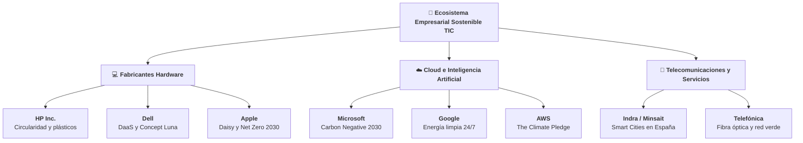

## Unidad 09 · Casos de empresas del sector informático

Banco de Casos Reales
Cloud Hyperscalers
Hardware & Telco
Memorias de Sostenibilidad

**Módulo 1708 · Sostenibilidad aplicada al sistema productivo**

  

    
7 Líderes

    
Empresas tecnológicas analizadas

  

  

    
100%

    
Datos de memorias oficiales auditadas

  

  

    
4 Sectores

    
Hardware, Cloud, Software y Telco

  

---

## Qué vas a aprender en esta unidad

- Leer una ficha de empresa TIC con ojo crítico: **datos, compromisos, KPIs y ODS**.
- Distinguir un **compromiso público** de un **dato verificado** con informe detrás.
- Elegir el caso correcto para cada trabajo: **T1, T2 o T3**.
- Contrastar siempre la cifra con el **informe ASG vigente** antes de citarla.

--

## El RA oficial que trabaja esta unidad

> "Analiza un plan de sostenibilidad de una empresa del sector, identificando sus grupos de interés, los aspectos ASG materiales y justificando acciones para su gestión y medición."

- Es el **RA6** del módulo 1708.
- Fuente: Real Decreto 659/2023, Anexo VIII (BOE-A-2023-16889).

--

## Los criterios de evaluación que vas a demostrar

- a) Se han identificado los principales **grupos de interés** de la empresa.
- b) Se han analizado los **aspectos ASG materiales** y sus expectativas.
- c) Se han definido **acciones** para minimizar impactos y aprovechar oportunidades.
- d) Se han determinado las **métricas de desempeño** según estándares utilizados.
- e) Se ha elaborado un **informe de sostenibilidad** con plan e indicadores.

--

## Y algo más: estas fichas sirven para todos los RAs

- **RA1 c) y d):** relaciona ODS con la Agenda 2030 y con riesgos/oportunidades.
- **RA4 d) y e):** aplica ecodiseño y analiza el ciclo de vida del producto.
- **RA5 f) y i):** aplica estrategias sostenibles y normativa ambiental.
- El fichero 09 es **apoyo a todos** los resultados de aprendizaje del módulo.

---

## Índice: siete casos, una plantilla y un examen

- **Bloque 1:** cómo se lee una ficha y por qué hay que verificarla.
- **Bloque 2:** HP, Microsoft, Google, Dell.
- **Bloque 3:** Indra/Minsait, IBM y Amazon.
- **Bloque 4:** casos complementarios y ficha-tipo para completar.

--

## Índice · Dónde acaba la presentación

- **Comprueba lo aprendido:** preguntas rápidas con respuestas.
- **Errores frecuentes** al citar empresas.
- **Trucos para el examen** y **Aplica esto** al sector TIC.
- **Resumen en 10 ideas** + **Cuestionario final** de 12 preguntas.

---

## Aviso de rigor: la cifra de ayer no vale hoy

- Las cifras y compromisos de sostenibilidad **cambian cada ejercicio**.
- Las fichas recogen el **perfil general** y los **compromisos públicos más conocidos**.
- Tú debes **contrastar los datos con el informe ASG o de sostenibilidad vigente** de cada empresa.
- Si no lo haces, estás citando datos caducados: eso se penaliza.

--

## Cómo verificar un dato antes de citarlo

1. Busca la sección **Sustainability / Impact / Investor relations** de la empresa.
2. Descarga el **informe del último ejercicio** disponible.
3. Anota la **fuente, el año y la página**: eso es tu bibliografía.
4. Si el dato no aparece, **no lo inventes**: di "no publicado".

---

## El ecosistema de casos tecnológicos

--

## Los 6 bloques de cada ficha de empresa

1. **Sector** y perfil de negocio en TIC.
2. **Compromisos** destacados de sostenibilidad (net-zero, PPA renovable).
3. **KPIs / métricas** típicos con sus unidades (tCO₂e, PUE, kg RAEE).
4. **ODS prioritarios** sugeridos (7, 9, 12, 13).
5. **Aspectos ASG materiales** y controversias reales.
6. **Aprovechamiento en clase** (trabajos T1, T2 o T3).

---

## HP Inc. · El reciclaje como argumento de negocio

- **Sector:** fabricación de hardware (ordenadores, impresoras, periféricos).
- Es el caso clásico de **economía circular en hardware**.
- Su punto fuerte: el **programa de recogida (take-back)** de cartuchos y equipos.

--

## HP · Datos de la ficha

- **Nombre:** HP Inc. (heredera de Hewlett-Packard).
- **Sector TIC:** hardware de sobremesa, portátiles, impresoras y periféricos.
- **Modelo de negocio:** venta de producto físico + consumibles (cartuchos).
- **Por qué importa:** cada cartucho vendido genera un residuo que hay que recoger.

--

## HP · Compromisos y políticas ASG

- **Líder en reciclaje** de cartuchos y de hardware.
- **Diseño circular** en portátiles y PCs.
- Uso de **plásticos recuperados** en sus productos.
- Objetivos de **reducción de la huella de carbono**.

--

## HP · KPIs, ODS y aspectos materiales

### KPIs y ODS

| KPI típico | Unidad | ODS sugeridos |
|---|---|---|
| Plástico reciclado | % en peso | 12 · Producción responsable |
| Hardware reciclado | kg | 9 · Innovación industrial |
| Huella de carbono | tCO₂e por alcance | 13 · Acción por el clima |
| Unidades recogidas | nº take-back | 12 · Consumo responsable |

### Aspectos ASG materiales

- **ASG materiales:** residuos electrónicos, plásticos, energía en fabricación, cadena de suministro, condiciones laborales.

--

## HP · Qué copiar en tus trabajos

- **T1:** usa HP como referencia de empresa que internaliza su residuo.
- **T2:** compara **hardware clásico frente a hardware ecodiseñado**.
- **T3:** diseña la **economía circular del cartucho y del PC**.
- Ideas reutilizables: take-back, plástico recuperado, desmontaje sencillo.

--

## HP · Pregunta para el aula

- Si HP vende menos impresoras por reciclar más cartuchos, **¿le baja el beneficio?**
- ¿O le sube la fidelidad del cliente y le baja el coste de materia prima?
- Reserva 3 minutos: defiende **una** postura con un KPI en la mano.

---

## Microsoft · Negativo en carbono, positivo en datos

- **Sector:** software y servicios cloud (Azure, Office, sistemas operativos).
- Su reto no es el residuo físico: es la **energía y el agua** de los data centers.
- Es el mejor caso para trabajar **métricas y planes de sostenibilidad**.

--

## Microsoft · Datos de la ficha

- **Sector TIC:** software, nube pública y productividad.
- **Producto dominante:** Azure + Microsoft 365.
- **Por qué importa:** su huella depende de la **electricidad** que compran y del **agua** de refrigeración.

--

## Microsoft · Compromisos y políticas ASG

- Objetivo de ser **carbon negative para 2030**.
- **Eliminar las emisiones históricas** para 2050 (captura + compensación).
- Data centers alimentados con **energía renovable**.
- **Transparencia:** informes ASG **anuales**.

--

## Microsoft · KPIs, ODS y aspectos materiales

### KPIs y ODS

| KPI típico | Qué mide | ODS |
|---|---|---|
| tCO₂e por alcance | emisiones 1, 2 y 3 | 13 · Clima |
| % energía renovable | limpieza de la red | 7 · Energía asequible |
| PUE de Azure | eficiencia del data center | 9 · Innovación |
| WUE de Azure | litros por kWh | 6 · Agua limpia |

### Aspectos ASG materiales

- **ASG materiales:** huella de carbono del cloud, consumo hídrico, privacidad y datos, ética de la IA, gobernanza.

--

## Microsoft · Qué copiar en tus trabajos

- **T2:** rediseña un **servicio cloud eficiente** (PUE y WUE como guía).
- **T3:** plan de reducción de **huella hídrica y energética** en Azure.
- Idea clave: **agua neta positiva** (reponer más agua de la que consumes).
- Útil para explicar que "carbon negative" va más allá de "cero emisiones".

--

## Microsoft · Pregunta para el aula

- Un data center consume mucha agua en una comarca con sequía.
- ¿Es suficiente con decir que es **carbon negative**?
- ¿Qué **grupo de interés** local sale perjudicado y qué métrica le pedirías?

---

## Google · La promesa de la energía limpia cada hora

- **Sector:** servicios digitales, nube e IA (Alphabet).
- Caso de referencia para trabajar **ODS, indicadores y compromisos internacionales**.
- Su particularidad: no basta con compensar al año, quiere **limpieza hora a hora**.

--

## Google · Datos de la ficha

- **Sector TIC:** buscador, publicidad, Android, YouTube, Google Cloud, IA.
- **Infraestructura:** una red enorme de data centers.
- **Por qué importa:** su huella se concentra en **energía** y en **circularidad de equipos**.

--

## Google · Compromisos y políticas ASG

- **Neutralidad de carbono desde 2007** (pionero de esa promesa).
- Objetivo: operar con energía **100 % libre de carbono en cada hora del año** para 2030.
- Programas de **economía circular** en equipos: Pixel y servidores.

--

## Google · KPIs, ODS y aspectos materiales

### KPIs y ODS

- **tCO₂e** por alcance.
- **MWh** de renovables compradas.
- **PUE medio** de sus instalaciones.
- **Unidades** reutilizadas y recicladas.
- **ODS sugeridos:** 7 (energía), 13 (clima), 9 (innovación e infraestructura).

### Aspectos ASG materiales

- **ASG materiales:** energía de data centers e IA, huella de carbono, circularidad de dispositivos, gobernanza de la IA y los datos.

--

## Google · Qué copiar en tus trabajos

- **T2:** rediseña un **data center o un servicio bajo neutralidad carbono**.
- **T3:** aplica el mismo criterio a un plan con indicadores y calendario.
- Idea reutilizable: "**libre de carbono cada hora**" es un KPI mucho más exigente que un promedio anual.
- Buen ejemplo para explicar la diferencia entre **compensar** y **evitar**.

--

## Google · Pregunta para el aula

- ¿Por qué "libre de carbono cada hora" es más exigente que "100 % renovable al año"?
- Piensa en una noche de invierno sin viento ni sol.
- ¿Qué solución técnica propones para esas horas críticas?

---

## Dell · Materiales reciclados y reparación fácil

- **Sector:** fabricación de hardware y servicios TI.
- Segundo gran caso de **economía circular** junto con HP.
- Su apuesta: **plástico reciclado** y **recogida de equipos al final de su vida**.

--

## Dell · Datos de la ficha

- **Sector TIC:** ordenadores, monitores, almacenamiento y servicios.
- **Modelo:** fabricación + venta a empresas y particulares.
- **Por qué importa:** combina residuo electrónico con **embalaje y logística**.

--

## Dell · Compromisos y políticas ASG

- Programas de **recogida y reciclaje** de equipos.
- Uso de **plásticos reciclados** en ordenadores y monitores.
- Objetivo de **cero emisiones netas para 2050**.

--

## Dell · KPIs, ODS y aspectos materiales

### KPIs y ODS

| KPI típico | Unidad | Trabajo donde brilla |
|---|---|---|
| Plástico recuperado | % | T2 · ecodiseño |
| Unidades recicladas | nº | T3 · recuperación postventa |
| tCO₂e por alcance | tCO₂e | T1 · análisis ASG |
| Eficiencia logística | gCO₂e/envío | T3 · plan sostenible |

- **ODS sugeridos:** 12, 9, 13.

### Aspectos ASG materiales

- **ASG materiales:** residuos electrónicos, plásticos reciclados, energía en fabricación, empaquetado, cadena de suministro.

--

## Dell · Qué copiar en tus trabajos

- **T2:** rediseña un **monitor o PC con materiales reciclados y fácil reparación**.
- **T3:** plan de **empaquetado sostenible** y de **recuperación postventa**.
- Ideas reutilizables: desmontabilidad, repuestos, embalaje sin plástico.
- Conexión con RA5: **índice de reparabilidad** y normativa de ecodiseño.

--

## Dell · Pregunta para el aula

- Si tu PC fuera fácil de reparar, **¿quién gana**: tú, el fabricante o el planeta?
- ¿Y si el fabricante pierde ventas de recambio?
- Proponed una **incentivo** que alinee las tres cosas.

---

## Indra / Minsait · El caso español más cercano a tu empleo

- **Sector:** consultoría tecnológica, software y soluciones digitales (**grupo español**).
- No fabrica hardware: **vende proyectos y digitalización**.
- **Muy recomendable en grado medio** por su cercanía al mercado laboral español.

--

## Indra / Minsait · Datos de la ficha

- **Sector TIC:** consultoría, integración, software a medida y servicios digitales.
- **Clientes:** Administración Pública, banca, energía, transporte.
- **Por qué importa:** su huella está en los **proyectos y en la plantilla**, no en una fábrica.

--

## Indra / Minsait · Compromisos y políticas ASG

- Soluciones digitales para **eficiencia energética**.
- Desarrollo de **smart cities** y **movilidad sostenible**.
- **Informes de sostenibilidad accesibles.**
- Alineación explícita con el **Pacto Verde Europeo**.

--

## Indra / Minsait · KPIs, ODS y aspectos materiales

### KPIs y ODS

- **tCO₂e** por alcance.
- **% de ingresos** de soluciones "verdes".
- **Nº de proyectos** de eficiencia energética.
- **Diversidad** de la plantilla.
- **ODS sugeridos:** 9 (innovación), 11 (ciudades sostenibles), 16 (instituciones), 7 (energía).

### Aspectos ASG materiales

- **ASG materiales:** huella de proyectos y personal, digitalización de la Administración, ciberseguridad, gobernanza tecnológica, empleo cualificado.

--

## Indra / Minsait · Qué copiar en tus trabajos

- **T1:** enfoque **local y europeo** de la sostenibilidad aplicada a la informática.
- **T2:** rediseño de una **solución de smart city**.
- **T3:** plan de sostenibilidad en **proyectos de digitalización para la Administración**.
- Truco: "% de ingresos verdes" es un KPI poco común y muy valorado en examen.

--

## Indra / Minsait · Pregunta para el aula

- Una ciudad contrata un sistema de farolas inteligentes.
- ¿Qué **KPIs** pedirías para demostrar que el proyecto es sostenible?
- Piensa en energía, mantenimiento, datos y ciudadanía.

---

## IBM · Sostenibilidad con memoria desde los años 70

- **Sector:** servicios de TI, nube, consultoría y hardware corporativo.
- Su diferencia: **continuidad histórica** en el reporte de sostenibilidad.
- Gran caso para trabajar **gobierno corporativo y ética de la IA**.

--

## IBM · Datos de la ficha

- **Sector TIC:** servicios empresariales, nube híbrida, consultoría, IA.
- **Modelo:** B2B, contratos largos con grandes organizaciones.
- **Por qué importa:** su relato se apoya en la **transparencia sostenida en el tiempo**.

--

## IBM · Compromisos y políticas ASG

- **Líder en IA** para optimización energética y ambiental.
- Data centers con **energías renovables**.
- Publica **informes de sostenibilidad desde los años 70**: continuidad histórica.

--

## IBM · KPIs, ODS y aspectos materiales

### KPIs y ODS

- **tCO₂e** por alcance.
- **% de energía renovable.**
- **Nº de casos de IA** aplicada a sostenibilidad.
- **Antigüedad del reporte ASG** (¡un KPI cualitativo!).
- **ODS sugeridos:** 9 (innovación), 13 (clima), 7 (energía).

### Aspectos ASG materiales

- **ASG materiales:** energía de infraestructuras, ética y transparencia de la IA, gobernanza corporativa, cadena de suministro.

--

## IBM · Qué copiar en tus trabajos

- **T2:** rediseño de un **servicio con IA eficiente**.
- **T3:** plan de **comunicación y transparencia ASG** con métricas aplicadas a IA.
- Ideas reutilizables: informe anual, comité de ética, auditoría externa.
- Buen ejemplo para el criterio **RA6 e)**: informe de sostenibilidad.

--

## IBM · Pregunta para el aula

- Si una IA decide cuándo ahorrar energía, **¿quién responde** si falla?
- ¿El programador, la empresa o el cliente?
- ¿Qué métrica usarías para auditar esa decisión?

---

## Amazon · Logística, cloud y un compromiso a 20 años

- **Sector:** cloud (AWS), comercio electrónico, logística e IA.
- Tiene **dos huellas** muy distintas: la de los data centers y la de los repartos.
- Caso ideal para **comparar alcance 2 y alcance 3**.

--

## Amazon · Datos de la ficha

- **Sector TIC:** infraestructura cloud, marketplace, streaming, dispositivos.
- **Logística propia:** almacenes, flota y reparto última milla.
- **Por qué importa:** su impacto se concentra en **energía, empaquetado y transporte**.

--

## Amazon · Compromisos y políticas ASG

- **"The Climate Pledge":** neutralidad neta de carbono para **2040**.
- **Flota de vehículos eléctricos.**
- Data centers con **renovables**.
- Reducción de la **huella logística**.

--

## Amazon · KPIs, ODS y aspectos materiales

### KPIs y ODS

| KPI típico | Unidad | Qué cuenta |
|---|---|---|
| tCO₂e por alcance | tCO₂e | huella total |
| % envíos neutros | % | logística verde |
| MWh renovables | MWh | energía limpia |
| Emisiones por paquete | gCO₂e/paquete | eficiencia logística |

- **ODS sugeridos:** 12, 13, 9.

### Aspectos ASG materiales

- **ASG materiales:** huella de data centers y logística, empaquetado, energía renovable, condiciones laborales en centros logísticos.

--

## Amazon · Qué copiar en tus trabajos

- **T2:** rediseño de un **data center o servicio bajo neutralidad carbono**.
- **T3:** plan de reducción de **huella hídrica y energética + logística verde**.
- Ideas reutilizables: envío consolidado, cajas a medida, estaciones de recarga.
- Dato de examen: el objetivo 2040 es **más ambicioso** que el net zero 2050 de muchos competidores.

--

## Amazon · Pregunta para el aula

- Cada "entrega en 2 horas" multiplica los kilómetros del reparto.
- ¿Es **sostenible** la comodidad inmediata?
- Proponed **2 medidas** que reduzcan la huella sin frenar la venta.

---

## Ronda de contraste: cuatro preguntas entre casos

- **HP frente a Microsoft:** ¿qué problema ASG domina en cada uno?
- **Google frente a Amazon:** ¿quién promete antes la neutralidad de carbono?
- **Dell frente a IBM:** ¿qué KPI usarías para compararlos en una tabla?
- **Indra frente a todos:** ¿qué gana el caso español en un trabajo de grado medio?

--

## Ronda de contraste · Respuestas orientativas

- HP: **residuo electrónico y plástico**. Microsoft: **energía y agua del cloud**.
- Google promete neutralidad total en **2030**; Amazon, en **2040**; Dell y Microsoft, **2050**.
- KPI comparador: **tCO₂e por alcance** (está en casi todas las fichas).
- Indra/Minsait gana en **cercanía laboral, lenguaje accesible y datos locales**.

--

## Más preguntas para debatir en parejas

- ¿Qué empresa tendrías en cuenta para un **T3 sobre IA responsable**?
- ¿Cuál para un **T2 sobre ecodiseño de hardware**?
- ¿Qué empresa tiene el **grupo de interés** más delicado: clientes, empleados o vecinos?
- Defiende tu elección en **1 minuto** con dos KPIs.

---

## Casos complementarios para ampliar el banco

| Empresa | Sector TIC | Aporte distintivo para clase |
|---|---|---|
| **Apple** | Hardware y software integrado | Robot "Daisy" de reciclaje; carbono neutro 2030; diseño modular |
| **Cisco** | Redes e infraestructura TIC | Net-zero 2030; eficiencia de equipos de red; "Green by Design" |
| **SAP** | Software corporativo (ERP, cloud) | Huella por transacción; ciclo de vida del software |
| **Telefónica / Movistar** | Red y telecomunicaciones | Descarbonización de la red; fibra eficiente; caso español |
| **Empresas locales / startups TIC** | Variedad | Anclan el módulo a tu entorno y al mercado laboral cercano |

--

## Casos complementarios · Cómo aprovecharlos

- **Apple:** ejemplo de **ecodiseño y circularidad** con robot de desmontaje (T2).
- **Cisco:** ideal para **redes eficientes**, encaja con el **RA5**.
- **SAP:** permite hablar de **"software verde"** y huella por servicio (T2).
- **Telefónica:** descarbonización de red y digitalización sostenible de empresas (T1/T3).

--

## Consejo didáctico: mezcla escalas

- Combina **multinacionales** (Microsoft, Google) con **empresas españolas** (Indra/Minsait, Telefónica).
- Eso aporta **contraste de escala y cercanía**.
- Facilita que te **proyectes laboralmente**: imagina dónde trabajarías tú.
- Regla práctica: cada trabajo, **un caso grande y uno cercano**.

---

## Ficha-tipo para que la completes tú

### Cabecera y primeros bloques

- **Empresa:** ______________ **Sector TIC:** ______________
- **Fuente del dato (informe ASG vigente):** ______________
- **1) Compromisos de sostenibilidad clave (2-3):** ______________
- **2) KPIs / métricas destacadas** con unidad y valor publicado: ______________

--

## Ficha-tipo · Segunda mitad

- **3) ODS prioritarios (3, justificados):** ______________
- **4) Aspectos ASG materiales:** al menos **3 de E**, **3 de S** y **2 de G**.
- **5) Riesgo principal y oportunidad principal:** ______________
- **6) Aprovechamiento en clase (T1/T2/T3):** ______________

--

## Ficha-tipo · Cómo se rellena bien

### Ejemplos de aspectos por letra

- **Ejemplo de E:** residuos electrónicos, energía en fabricación, huella de carbono.
- **Ejemplo de S:** condiciones laborales, privacidad, ética de la IA, diversidad.
- **Ejemplo de G:** transparencia del informe, ciberseguridad, cadena de suministro.
- Cada ODS necesita **una frase de justificación**, no basta con el número.

---

## Comprueba lo aprendido · Tanda 1

1. ¿Qué tres siglas equivalen a ASG y qué significa cada letra?
2. Nombra dos KPIs típicos de HP y dos de Microsoft.
3. ¿Qué ODS aparecen en casi todas las fichas del sector TIC?
4. ¿Qué obligación tiene el alumnado antes de citar una cifra?

--

## Respuestas · Tanda 1

- **1.** Ambientales, Sociales y de Gobernanza (Environmental, Social, Governance).
- **2.** HP: % plástico reciclado, kg de hardware reciclado. Microsoft: tCO₂e por alcance, % de energía renovable.
- **3.** El **13 (clima)**, el **9 (innovación)** y el **12 (consumo responsable)**; también el **7 (energía)**.
- **4.** Contrastar el dato con el **informe ASG vigente** y citar fuente y año.

---

## Comprueba lo aprendido · Tanda 2

1. ¿Qué significa "carbon negative" de Microsoft frente a "net zero"?
2. ¿Qué data center tiene el KPI "WUE"? ¿Y el "PUE"?
3. ¿Qué empresa española aparece en el banco de casos y por qué es útil?
4. Menciona dos aspectos ASG materiales de Amazon.

--

## Respuestas · Tanda 2

- **1.** **Net zero** = reducir al mínimo y compensar el resto. **Carbon negative** = retirar más CO₂ de la atmósfera del que se emite.
- **2.** Ambos pertenecen a un **data center**: **PUE** = eficiencia energética (total/IT); **WUE** = litros de agua por kWh.
- **3.** **Indra / Minsait**: acerca el módulo al mercado laboral español y al Pacto Verde Europeo.
- **4.** Huella de data centers y logística, empaquetado, energía renovable, condiciones laborales en centros logísticos.

---

## Comprueba lo aprendido · Tanda 3

1. Ordena por fecha de objetivo: Amazon, Google, Dell, Microsoft.
2. ¿Qué ficha usarías para un trabajo sobre ecodiseño de un monitor?
3. ¿Qué es el "take-back" y quién lo lidera en este banco de casos?
4. Cita dos grupos de interés de una empresa cloud.

--

## Respuestas · Tanda 3

- **1.** Google **2030** (energía libre de carbono cada hora) → Amazon **2040** (Climate Pledge) → Microsoft **2030** carbon negative y Dell **2050** cero emisiones netas.
- **2.** La de **Dell**: rediseño de monitor/PC con materiales reciclados y fácil reparación (T2).
- **3.** **Recogida de equipos o consumibles al final de su vida**; caso emblemático: **HP**.
- **4.** Clientes, inversores, empleados, proveedores, regulador, comunidad, ONG, prensa.

---

## Errores frecuentes al presentar un caso

- Citar cifras **sin año ni fuente**: el dato se considera caducado.
- Confundir **compromiso** con **logro**: "queremos en 2050" no es "hemos logrado".
- Copiar el **mismo KPI** para todas las empresas: no todos aplican.
- **Sumar los alcances 1, 2 y 3** en una sola cifra sin distinguirlos.

--

## Errores frecuentes · Los tres más castigados

- **1.** Presentar HP y Dell como si fueran la misma empresa: una se centra en cartuchos, otra en monitores y empaquetado.
- **2.** Decir que Microsoft no tiene residuos: su residuo es **agua y energía**.
- **3.** Elegir ODS de moda sin justificarlos con el **modelo de negocio**.

--

## Errores frecuentes · Señales de greenwashing en una ficha

- Frases bonitas sin **KPI ni fecha**.
- Solo **compensaciones** y ninguna reducción medida.
- Informes que **no nombran** a los grupos de interés afectados.
- Si ves eso en una fuente: **descártala o matízala** en tu trabajo.

---

## Trucos para el examen

- Aprende **una empresa por tipo**: hardware (HP), cloud (Microsoft), servicio (Indra), logística (Amazon).
- Memoriza **un KPI con unidad** de cada una: te piden ejemplos concretos.
- Recuerda los **ODS transversales: 7, 9, 12 y 13**.

--

## Trucos para el examen · El esquema de 6 bloques

- Si te piden "analiza una empresa del sector", responde con esta estructura:
- **Sector → compromisos → KPIs → ODS → aspectos ASG → aprovechamiento.**
- Te garantiza cobrir los criterios **RA6 a), b), c) y d)** en una sola respuesta.

--

## Trucos para el examen · Frases que suman puntos

- "Los aspectos materiales se eligen por **materialidad**, no por gusto."
- "El **alcance 3** suele ser el mayor en TIC: proveedores, equipos y logística."
- "Contrasto con el **informe ASG del ejercicio vigente**, fuente y año."
- "Relaciono el KPI con su **estándar**: PUE con Green Grid, tCO₂e con ISO 14064."

---

## Aplica esto · Tu ficha de empresa real

1. Elige una empresa TIC donde te gustaría trabajar.
2. Localiza su **informe de sostenibilidad** más reciente.
3. Rellena la **ficha-tipo** completa con 6 bloques.
4. Prepara **3 minutos** de exposición con dos KPIs y tres ODS.

--

## Aplica esto · Reto de equipo (30 minutos)

- Grupos de 3 o 4 personas; cada grupo recibe **una empresa distinta**.
- Entregad: **tabla de 4 KPIs**, **3 ODS justificados** y **1 riesgo + 1 oportunidad**.
- Comparad luego los resultados: ¿los KPIs elegidos coinciden?
- Criterio de nota: **fuente citada con año**.

--

## Aplica esto · Conexión con vuestros trabajos

- **T1 (análisis):** usa la ficha para caracterizar la empresa y sus grupos de interés.
- **T2 (rediseño):** propón un producto o servicio con **ecodiseño** y ciclo de vida.
- **T3 (plan):** define acciones, métricas y calendario, con normativa aplicable.
- Las siete fichas están pensadas para **alimentar los tres trabajos**.

---

## Resumen en 10 ideas

1. Una ficha tiene **6 bloques**: sector, compromisos, KPIs, ODS, aspectos ASG y aprovechamiento.
2. Toda cifra necesita **fuente, año y páginas**: si no, no se cita.
3. **HP y Dell** mandan en residuo y materiales; **Microsoft y Google**, en energía.
4. **Amazon** suma logística: es el mejor ejemplo de alcance 3.
5. **Indra/Minsait** es el caso español y el más cercano a tu primer empleo.

--

## Resumen en 10 ideas · continuación

6. **IBM** destaca por la continuidad histórica del reporte y la ética de la IA.
7. Los ODS transversales del sector son **7, 9, 12 y 13**.
8. "Carbon negative", "net zero" y "libre de carbono cada hora" **no son lo mismo**.
9. Un buen KPI tiene **unidad, frecuencia y responsable**.
10. Estas fichas son **apoyo a todos los RAs**, en especial al **RA6**.

---

## Cuestionario final · Bloque 1

1. Define "materialidad" y "doble materialidad".
2. ¿Qué significa el alcance 3 y por qué suele ser el mayor en TIC?
3. Cita tres KPIs de Microsoft con su unidad.
4. ¿Qué compromiso concreto tiene HP con los cartuchos y el hardware?

--

## Respuestas · Bloque 1

- **1.** Materialidad: relevancia de un tema ASG para la empresa. Doble materialidad: impacto de la empresa en el mundo **y** impacto del mundo en la empresa.
- **2.** Alcance 3: resto de la cadena de valor (proveedores, uso y fin de vida). Es el mayor en TIC porque la fabricación de equipos y la logística son intensivas.
- **3.** tCO₂e por alcance; % de energía renovable; PUE o WUE de Azure; agua neta positiva.
- **4.** Programas de **recogida (take-back)** y reciclaje de cartuchos y hardware, con diseño circular.

---

## Cuestionario final · Bloque 2

5. Ordena los objetivos: Dell, Google, Amazon, Microsoft.
6. ¿Qué grupo de interés sale perjudicado si un data center consume mucha agua?
7. ¿Qué aporta Indra/Minsait a la clase que no aportan las multinacionales?
8. Menciona dos compromisos públicos de Google.

--

## Respuestas · Bloque 2

- **5.** Google **2030** → Amazon **2040** → Dell **2050**; Microsoft: carbon negative **2030** y emisiones históricas eliminadas en **2050**.
- **6.** La **comunidad local** y el sector agrícola de la zona; se le pediría **WUE** y plan de reutilización de agua.
- **7.** Cercanía al mercado laboral español, Pacto Verde Europeo, proyectos de Administración Pública y datos locales.
- **8.** Neutralidad de carbono desde 2007; energía 100 % libre de carbono hora a hora en 2030; economía circular en Pixel y servidores.

---

## Cuestionario final · Bloque 3

9. Diferencia un compromiso de un logro verificable.
10. ¿Qué significa "greenwashing" y cómo detectarlo en una ficha?
11. Cita dos estándares útiles para medir lo que afirma una empresa TIC.
12. Aplica la ficha-tipo: elige una empresa y nombra 2 riesgos y 2 oportunidades.

--

## Respuestas · Bloque 3

- **9.** Compromiso: promesa con fecha (ej. cero neto 2050). Logro: resultado **ya medido** en el informe ASG con año y alcance.
- **10.** Comunicación que exagera o falsea el desempeño ASG: se detecta con ausencia de KPI, ausencia de fecha y exceso de compensaciones.
- **11.** **ISO 14064** o **GHG Protocol** para GEI; **GRI** para reporte; **CDP** para calificación; **PUE/WUE** de Green Grid para data centers.
- **12.** Ejemplo: riesgos → dependencia energética, obsolescencia de equipos; oportunidades → ahorro energético, reputación y acceso a financiación ASG.

---

## Cierre de la unidad 09

- Ya sabes **leer, comparar y criticar** una empresa TIC.
- Tu siguiente paso: abrir el informe ASG de una empresa real y **rellenar la ficha-tipo**.
- Dato de rigor: **contrasta siempre, cita siempre**.
- Fin de la presentación · **Sostenibilidad aplicada al sistema productivo (1708)**
